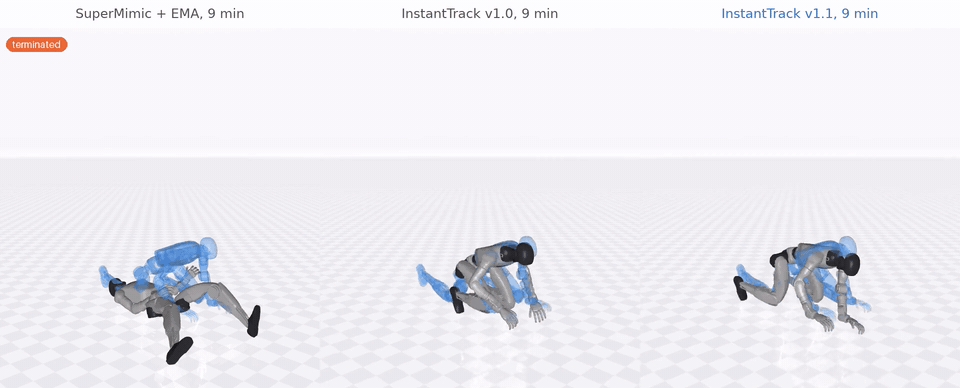
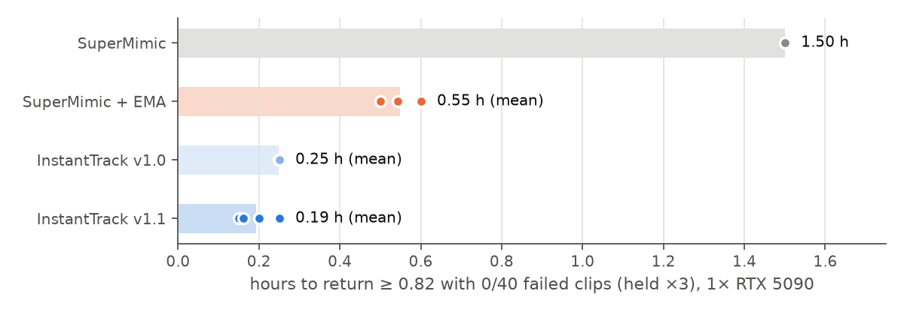
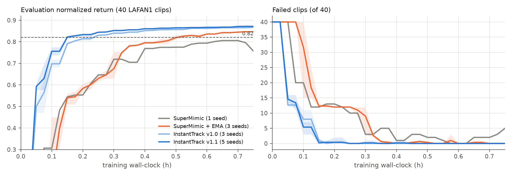

# InstantTrack

**Whole-body motion tracking for the Unitree G1 in about 12 minutes on one GPU.**
InstantTrack trains a single policy for all 40 LAFAN1 clips (2.45 h of motion) to an evaluation
normalized return of 0.82 with **0/40 failed clips in 0.19 h on one RTX 5090** (mean of 5 seeds,
range 0.15–0.25 h). On the same machine, simulator, MDP and evaluator, our reimplementation of
SuperMimic needs **1.50 h**, and SuperMimic with the policy EMA we add needs **0.55 h**. InstantTrack
is also more accurate and makes cleaner foot contact.

> **v1.1.0 (2026-10-30).** The policy now outputs a correction on top of the next reference joint
> pose (`--ref_residual 1.0`). Time to target: 0.25 h → **0.19 h** (2.2× → **2.8×** over SuperMimic +
> EMA), with lower pose errors and no change in iterations per second. Details in
> [What's new in v1.1](#whats-new-in-v11) and [CHANGELOG.md](CHANGELOG.md). The v1.0 configuration
> stays available as the `instanttrack_v1.0` preset.

InstantTrack builds on SuperMimic (one differentiable world model, backpropagation through imagined
rollouts) and adds InstantMimic-style GPU work on the training loop, a few algorithmic changes and a
contact reward. It runs on [mjlab](https://github.com/mujocolab/mjlab) / MuJoCo Warp and is
installed with [uv](https://docs.astral.sh/uv/).

**Project page:** <https://huy-quang-dao.github.io/instantTrack/>



*All three policies trained for 9 minutes (0.15 h) on one RTX 5090, shown on `fallAndGetUp1_subject4`.
At this checkpoint, over all 40 clips, SuperMimic + EMA fails 12, InstantTrack v1.0 fails 2 and
InstantTrack v1.1 fails 0 (`eval.csv` of seed 0). Solid robot: policy simulated in MuJoCo Warp. Faint
blue ghost: reference motion. More videos on the [project page](https://huy-quang-dao.github.io/instantTrack/).*

| on 1× RTX 5090, 40 LAFAN1 clips | SuperMimic | SuperMimic + EMA | InstantTrack v1.0 | **InstantTrack v1.1** |
|---|---|---|---|---|
| seeds | 1 | 3 | 3 | 5 |
| time to return ≥ 0.82 with 0/40 failed clips (held ×3), mean | 1.50 h | 0.55 h | 0.25 h | **0.19 h** |
| per seed | 1.50 | 0.50 / 0.54 / 0.60 | 0.25 / 0.25 / 0.25 | 0.15 / 0.16 / 0.25 / 0.20 / 0.20 |
| speed-up over SuperMimic + EMA | 0.4× | 1× | 2.2× | **2.8×** |
| training iterations per second | 3.05 | 3.08 | 6.32 | 6.28 |
| return / failed clips after 0.15 h (mean) | 0.545 / 12 | 0.540 / 12.3 | 0.791 / 1.0 | **0.822 / 0.2** |
| body orientation error, 0.75 h (°) | 12.5 | 11.1 | 7.5 | **6.5** |
| contact agreement with the reference, 0.75 h | 0.727 | 0.719 | 0.812 | **0.817** |
| foot slip in contact, 0.75 h (cm/s; the reference itself: 10.2) | 8.44 | 8.00 | 6.62 | **6.59** |

All numbers come from runs in this repository. Each run's evaluation log and training log are in
[`results/runs/`](results/runs/), and every table and figure is regenerated from them by
`tools/make_report.py`. Read [How to read these numbers](#how-to-read-these-numbers) before quoting
them.

**Contents:** [What's new in v1.1](#whats-new-in-v11) · [What InstantTrack changes](#what-instanttrack-changes) ·
[Results](#results) · [How to read these numbers](#how-to-read-these-numbers) ·
[Setup](#setup) · [Training](#training) · [Evaluation](#evaluation-and-metrics) ·
[Reproducing the tables](#reproducing-the-tables) · [Repository layout](#repository-layout) ·
[Attribution and licenses](#attribution-and-licenses) · [Citation](#citation)

---

## What's new in v1.1

Release date 2026-10-30. Full list in [CHANGELOG.md](CHANGELOG.md).

**Change.** One architectural change to the policy head, enabled by `--ref_residual 1.0` and part of
the `instanttrack` preset. In SuperMimic, and in InstantTrack v1.0, the decoder's output *a* is an
offset from the robot's default standing pose: the joint targets are q_default + α·a. An untrained
policy therefore commands the standing pose, and the first training minutes are spent learning to
reproduce the reference motion itself. In v1.1 the decoder outputs a correction on top of the next
reference joint pose, which the policy already receives in its goal input:

  a = decoder(z, o) + β · (q_ref(t+1) − q_default) / α,  with β = 1.

The joint targets become q_ref(t+1) + α·decoder(z, o). Nothing else changes: the simulator, world
model, reward, observation, evaluation and deployment inputs are the same. The policy does not need
any new input, and the extra cost is one addition per step. q_default and α are stored as buffers in
the checkpoint, and `eval_batch.py`, `eval_metrics.py`, `evaluate.py` and `export_onnx.py` read the
flag from the checkpoint's `args`.

**Effect.** Same protocol as v1.0: a checkpoint every 3 minutes, evaluated offline on all 40 clips.

| | v1.0 | v1.1 |
|---|---|---|
| seeds | 3 | 5 |
| first checkpoint with return ≥ 0.82 and 0 failed clips | 0.25 / 0.25 / 0.25 h | 0.15 / 0.16 / 0.15 / 0.15 / 0.15 h |
| same, held for 3 checkpoints | 0.25 / 0.25 / 0.25 h (mean 0.25) | 0.15 / 0.16 / 0.25 / 0.20 / 0.20 h (mean 0.19) |
| iterations at "held" | 5900 / 6000 / 5956 | 3687 / 4000 / 5847 / 4868 / 4787 |
| iterations per second | 6.32 | 6.28 |
| return, 0.75 h (3 seeds) | 0.867 ± 0.001 | 0.872 ± 0.003 |
| body position / orientation error, 0.75 h | 3.53 cm / 7.5° | 3.20 cm / 6.5° |
| joint error, 0.75 h | 4.56° | 4.12° |
| contact agreement / foot slip, 0.75 h | 0.812 / 6.62 cm/s | 0.817 / 6.59 cm/s |
| penetration, 0.75 h | 0.052 mm | 0.055 mm |
| root drift, 0.75 h | 61 ± 5 cm | 61 ± 3 cm |
| 1.5 h run (seed 0): return / body ori / contact agreement | 0.877 / 6.4° / 0.829 | 0.881 / 5.8° / 0.837 |

The gain is in iterations, not in speed per iteration: v1.1 reaches the target in 3.7k–5.8k
iterations instead of ~6k. Every v1.1 seed reaches the target at the first or second checkpoint
after 0.15 h. In three of five seeds the "held ×3" time is later, because one or two hard clips
(`fallAndGetUp1_subject5`, `fallAndGetUp2_subject2`, `jumps1_subject2`) fail at a single checkpoint.
With the 1.5 h run, normalized return now matches SuperMimic + EMA (0.881 vs 0.879–0.880), which v1.0
did not (0.877).

**What did not change or got worse.** Root drift is unchanged and still worse than SuperMimic + EMA
(55–64 cm vs 50–54 cm). Penetration is 0.003 mm higher than v1.0. A β of 0.5 is between v1.0 and
v1.1 (0.17 h, one seed).

**Tried in this round and not adopted** (all single seed, listed with numbers under
[What did not help](#what-did-not-help); the flags are kept so the runs can be reproduced):
- `--root_reward`: a wide-kernel global root-position term in imagination, aimed at the root drift.
  Drift did not improve (56–60 cm) and time to target did not improve.
- `--wm_ens K --wm_ens_pen λ`: K increment heads on the world-model trunk and an imagination penalty
  on their disagreement. The heads' disagreement collapses to ~1e-4, and the penalty slowed learning
  (0.25 h and 0.35 h vs 0.15 h).
- `--pi_experts 2`: a mixture-of-experts policy decoder gated on the motion latent. Same iterations
  to target, but 18 % fewer iterations per second (0.20 h).

**Compatibility.** No breaking change. Checkpoints and logs from v1.0 load and evaluate as before: the
new flags default to the v1.0 behaviour, and the v1.0 configuration is the `instanttrack_v1.0`
preset. The `instanttrack` preset now means v1.1.

## What InstantTrack changes

The baseline is SuperMimic (Liao et al., 2026). One world model, an MLP 2048³, predicts the next
robot state. The policy is trained by backpropagating the imagined return through 32 world-model
steps, with a critic bootstrap, and a replay buffer is filled from 4096 simulated robots. Run with no
flags, `python -m instanttrack.train` is this baseline with the paper's hyperparameters. **Every
InstantTrack change is a flag**, so all methods share the simulator, MDP, reward, termination, domain
randomization and evaluator.

| change | flag | kind | what it does |
|---|---|---|---|
| EMA policy | `--pi_ema 0.995` | algorithm | Checkpoints and evaluation use a Polyak average of the policy weights. On its own this is ~2.7× faster than SuperMimic, so **we count SuperMimic + EMA as the fair baseline**. |
| No host syncs | `--no_sync` | systems | Fixed-size start sampling (stable sort) and on-GPU checks for frozen normalizers and non-finite gradients, so no CPU↔GPU sync happens inside an iteration. |
| Fused optimizer | `--fused_adam` | systems | Fused Adam, plus compiled GAE targets and critic loss. |
| Fused 3×3 rotations | `--fused_rot` | systems | Rotation products in FK, reward, observation and world model are written element-wise, so inductor fuses them instead of sending them to cuBLAS as batched GEMVs. Same result to 1.5e-6. |
| More compilation | `--compile_more` | systems | `torch.compile` of reward, termination, observation, goal and the world-model normalizer inputs. |
| Learning-rate / WM updates | `--lr 4e-4 --wm_batches 5` | hyperparameters | lr 4e-4 instead of the paper's 2e-4 and 5 instead of 10 world-model batches per iteration. |
| Smaller world model | `--wm_hidden 1024,1024,1024` | architecture size | Same per-iteration learning and +28 % iterations per second. |
| Failure-focused resets | `--fail_reset 0.3` | algorithm | Tracks a per-bin termination rate (EMA) at the 1 s bin where each episode fails. 30 % of resets start one bin before recent failure points, mixed with SuperMimic's return-based bin sampling. Removes most of the single-clip "flicker" that delays the 3-checkpoint criterion. |
| Contact reward | `--contact_reward 0.25` | reward (training only) | In imagination, a differentiable foot-contact indicator, σ((4.5 cm − z_ankle) / 5 mm), is matched to the reference contact state, and horizontal foot speed is penalized while the reference foot is down. **Evaluation uses the unchanged SuperMimic reward.** |
| Reference-residual policy (v1.1) | `--ref_residual 1.0` | architecture | The decoder outputs a correction on top of the next reference joint pose (read from the goal input) instead of an offset from the default pose, so an untrained policy already commands the reference. |

Per iteration, the systems changes take the training loop from 315 ms to 209 ms under
`torch.profiler`, and from 25.3k to 15.2k CUDA kernel launches. The largest single item was ~57 ms of
fp32 `aten::bmm` from 3×3 rotations. The breakdown comes from `train.py --torch_profile 5` and
`tools/trace_summary.py`.

## Results

Setup for all runs: one NVIDIA RTX 5090 (32 GB) with 32 CPU threads and 4096 parallel environments.
The software stack is mjlab 1.6.0, MuJoCo Warp 3.11, Warp 1.16 and torch 2.9.0 + CUDA 12.8. A
checkpoint is saved every 3 minutes of training wall-clock and evaluated offline afterwards, so
evaluation time is not counted as training time.

### Time to target

**Target:** evaluation normalized return ≥ 0.82 with 0 of 40 clips failed, **held for 3 consecutive
checkpoints**. We use the 0.82 threshold of the SuperMimic paper and add the 0-failure and
held-for-3 conditions, so a single lucky checkpoint does not count.



| method | seeds | held at (h) | mean (h) | iteration at held | it/s | vs SuperMimic + EMA |
|---|---|---|---|---|---|---|
| SuperMimic | 1 | 1.50 | 1.50 | 16665 | 3.05 | 0.4× |
| SuperMimic + EMA | 3 | 0.50 / 0.54 / 0.60 | 0.55 | 5749 / 6000 / 6971 | 3.08 | 1.0× |
| InstantTrack v1.0 | 3 | 0.25 / 0.25 / 0.25 | 0.25 | 5900 / 6000 / 5956 | 6.32 | 2.2× |
| **InstantTrack v1.1** | 5 | **0.15 / 0.16 / 0.25 / 0.20 / 0.20** | **0.19** | 3687 / 4000 / 5847 / 4868 / 4787 | 6.28 | **2.8×** |

The speed-up has two sources. InstantTrack runs ~2× more iterations per second than SuperMimic, and
v1.1 also needs fewer iterations: 3.7k–5.8k, against 5.7k–7.0k for SuperMimic + EMA and ~6k for
v1.0. Two additional 1.5 h runs of seed 0 held the target from **0.20 h** (v1.0,
`e67_final_long_s0`, and v1.1, `e80_rres10_long_s0`). The median of the five v1.1 seeds is 0.20 h;
the first checkpoint that meets the target is at 0.15–0.16 h for all five.

### Equal training time



Mean over seeds of normalized return / failed clips:

| method | 0.15 h | 0.25 h | 0.50 h | 0.75 h |
|---|---|---|---|---|
| SuperMimic (1 seed) | 0.545 / 12 | 0.646 / 10 | 0.775 / 2 | 0.757 / 5 |
| SuperMimic + EMA | 0.540 / 12.3 | 0.630 / 12.0 | 0.819 / 0.3 | 0.847 / 0.0 |
| InstantTrack v1.0 | 0.791 / 1.0 | 0.831 / 0.0 | 0.857 / 0.0 | 0.867 / 0.0 |
| **InstantTrack v1.1** (5 seeds) | **0.822 / 0.2** | **0.844 / 0.0** | **0.865 / 0.0** | **0.871 / 0.0** |

### Tracking accuracy and contact

All 40 clips are run once from their first frame, with no randomization or noise, a deterministic
policy and friction 1.0. Metrics are averaged over all alive control steps (`tools/eval_metrics.py`).
Mean ± std over 3 seeds, after **0.75 h** of training:

| method | return ↑ | failed ↓ | body pos (cm) ↓ | body ori (°) ↓ | joints (°) ↓ | contact agreement ↑ | foot slip (cm/s) ↓ | penetration (mm) ↓ | root drift (cm) ↓ |
|---|---|---|---|---|---|---|---|---|---|
| SuperMimic (1 seed) | 0.775 | 4 | 5.29 | 12.5 | 6.15 | 0.727 | 8.44 | 0.066 | 116 |
| SuperMimic + EMA | 0.852 ± 0.002 | 0 | 4.60 ± 0.03 | 11.1 ± 0.2 | 5.61 ± 0.05 | 0.719 ± 0.001 | 8.00 ± 0.06 | 0.063 ± 0.003 | **54 ± 1** |
| InstantTrack v1.0, no contact reward | **0.873 ± 0.001** | 0 | 3.50 ± 0.08 | 7.7 ± 0.3 | 4.15 ± 0.02 | 0.738 ± 0.002 | 7.73 ± 0.08 | 0.057 ± 0.001 | 58 ± 3 |
| InstantTrack v1.0 | 0.867 ± 0.001 | 0 | 3.53 ± 0.04 | 7.5 ± 0.1 | 4.56 ± 0.02 | 0.812 ± 0.000 | 6.62 ± 0.04 | **0.052 ± 0.001** | 61 ± 5 |
| **InstantTrack v1.1** | 0.872 ± 0.003 | 0 | **3.20 ± 0.04** | **6.5 ± 0.0** | **4.12 ± 0.01** | **0.817 ± 0.003** | **6.59 ± 0.05** | 0.055 ± 0.001 | 61 ± 3 |

The v1.1 row uses seeds 0–2 (`results/metrics_a1_075h.md`).

After **1.5 h** of training (seed 0):

| method | return | body pos (cm) | body ori (°) | joints (°) | contact agreement | foot slip (cm/s) | penetration (mm) | root drift (cm) |
|---|---|---|---|---|---|---|---|---|
| SuperMimic | 0.853 | 4.16 | 9.6 | 4.84 | 0.733 | 8.11 | 0.064 | 84 |
| SuperMimic + EMA | 0.880 | 3.83 | 9.2 | 4.65 | 0.733 | 7.78 | 0.057 | 49 |
| InstantTrack v1.0, no contact reward | **0.890** | 3.03 | 5.9 | **3.70** | 0.752 | 7.56 | 0.052 | **42** |
| InstantTrack v1.0 | 0.877 | 3.27 | 6.4 | 3.98 | 0.829 | 6.48 | **0.046** | 62 |
| **InstantTrack v1.1** | 0.881 | **2.95** | **5.8** | 3.76 | **0.837** | 6.49 | 0.050 | 55 |

The v1.1 row was evaluated in a later session (`results/metrics_a1_150h.md`). In that session we
re-evaluated the SuperMimic + EMA and v1.0 checkpoints as well, and got return 0.879 / 0.878 and root
drift 50 / 59 cm, against 0.880 / 0.877 and 49 / 62 cm above. Re-running the evaluator on the same
checkpoint therefore moves return by about ±0.001 and root drift by a few cm (MuJoCo Warp on the GPU
is not bit-deterministic), so differences of that size between rows are not meaningful.

Definitions:
- *Body pos / ori*: RMS error of the 14 tracked bodies, with the reference re-anchored to the robot
  root as in the reward.
- *Contact agreement*: fraction of foot-frames whose contact state (ankle-roll origin below 4.5 cm)
  matches the reference.
- *Foot slip*: horizontal foot speed while the simulated foot is in contact.
- *Root drift*: global root position error.

Full tables: [`results/metrics_075h.md`](results/metrics_075h.md),
[`results/metrics_150h.md`](results/metrics_150h.md) (v1.0 and baselines),
[`results/metrics_a1_075h.md`](results/metrics_a1_075h.md),
[`results/metrics_a1_150h.md`](results/metrics_a1_150h.md) and
[`results/metrics_r2a_075h.md`](results/metrics_r2a_075h.md) (v1.1 round).

### Ablation ladder

Each row adds one change to the row above. Times are "held ×3".

| configuration | seeds | held at (h) | mean (h) | it/s | best return (≤ 0.75 h) |
|---|---|---|---|---|---|
| SuperMimic (paper hyperparameters) | 1 | 1.50 | 1.50 | 3.05 | 0.863 |
| + EMA policy 0.995 | 3 | 0.50 / 0.54 / 0.60 | 0.55 | 3.08 | 0.879 / 0.850 / 0.854 |
| + lr 4e-4, 5 WM batches, no host syncs, fused Adam | 3 | 0.29 / 0.30 / 0.35 | 0.31 | 3.51 | 0.872 / 0.867 / 0.873 |
| + fused 3×3 rotations | 1 | 0.30 | 0.30 | 4.14 | 0.872 |
| + compiled reward / obs / goal | 3 | 0.25 / 0.25 / 0.49 | 0.33 | 4.88 | 0.878 / 0.878 / 0.875 |
| + world model 1024³ (was 2048³) | 3 | 0.30 / 0.20 / 0.30 | 0.27 | 6.35 | 0.878 / 0.880 / 0.881 |
| + failure-focused resets | 3 | 0.20 / 0.20 / 0.25 | 0.22 | 6.29 | 0.875 / 0.874 / 0.874 |
| + contact reward 0.25 = **InstantTrack v1.0** | 3 | 0.25 / 0.25 / 0.25 | 0.25 | 6.32 | 0.869 / 0.869 / 0.864 |
| + reference-residual policy = **InstantTrack v1.1** | 5 | 0.15 / 0.16 / 0.25 / 0.20 / 0.20 | 0.19 | 6.28 | 0.873 / 0.873 / 0.871 / 0.874 / 0.873 |

For the first row the SuperMimic run is 2 h long, so its best return is taken over the full run.

The contact reward costs ~0.03 h of time-to-target and ~0.007 return. In exchange, contact agreement
rises from 0.74 to 0.81 and foot slip falls 15 %. If you only care about the SuperMimic metric, use
the `instanttrack_track` preset, which is the row above it.

### What did not help

We report every variant we tried; single seed unless stated. Most were tried on an earlier
configuration (the "on top of" column), so read them as directions, not final verdicts.

| change | on top of | seeds | held at (h) | it/s |
|---|---|---|---|---|
| Smaller policy and WM (1024-512-256) | SuperMimic | 1 | 1.20 | 4.20 |
| Demonstration replay (DiffMimic) | SuperMimic + EMA | 1 | 0.59 | 3.18 |
| Policy batch 2048 | SuperMimic + EMA | 1 | 0.55 | 3.66 |
| EMA 0.999 | SuperMimic + EMA | 1 | 0.55 | 3.13 |
| lr 6e-4 | + lr 4e-4, wm5 | 1 | 0.40 | 3.27 |
| 3 WM batches | + lr 4e-4 | 1 | 0.45 | 3.93 |
| Horizon 24 | + lr 4e-4, wm5 | 1 | 0.30 | 4.31 |
| Horizon 16 | + compile_more | 1 | 0.30 | 7.02 |
| Foot-contact world-model loss 0.05 (PhysMamba-style) | + lr 4e-4, wm5 | 1 | 0.35 | 3.30 |
| Anchored imagination (on-policy corrections) | + lr 4e-4, wm5 | 1 | 0.31 | 3.02 |
| 2 critic epochs | + lr 4e-4, wm5 | 1 | 0.40 | 3.81 |
| UTD 0.5 | + lr 4e-4, wm5 | 1 | 0.40 | 3.72 |
| CUDA graphs (`--cudagraphs`, torch.compile reduce-overhead) | + compile_more | 1 | 0.25 | 5.11 |
| WM window 4 | + compile_more | 1 | 0.25 | 5.45 |
| Contact-mode world model (`--wm_contact 0.1`, 4 heads mixed by predicted foot contact) | + fail_reset | 3 | 0.30* / 0.20 / 0.20 | 6.12 |
| Contact reward 0.5 | + fail_reset | 3 | 0.25 / 0.30 / 0.35 | 6.21 |
| Wide-kernel root reward 0.5, std 1 m (`--root_reward 0.5`) | v1.0 | 1 | 0.28 | 6.30 |
| Wide-kernel root reward 1.0, std 1 m | v1.0 | 1 | 0.35 | 6.28 |
| Wide-kernel root reward 0.5, std 0.5 m (`--root_reward_std 0.5`) | v1.0 | 1 | 0.25 | 6.35 |
| Reference residual β = 0.5 (v1.1 uses 1.0; same seed: 0.15 h) | v1.0 | 1 | 0.17 | 6.20 |
| WM ensemble, 4 heads, disagreement penalty 100 (`--wm_ens 4 --wm_ens_pen 100`) | v1.1 | 1 | 0.25 | 6.12 |
| WM ensemble, 4 heads, disagreement penalty 300 | v1.1 | 1 | 0.35 | 6.09 |
| Mixture-of-experts policy, 2 decoders (`--pi_experts 2`) | v1.1 | 1 | 0.20 | 5.18 |

\* This run followed a machine reboot that cleared the torch.compile cache. Cold compilation cost
about 0.05 h of it.

The v1.1-round variants were compared with the same seed of the configuration they modify (v1.0
seed 0: 0.25 h; v1.1 seed 0: 0.15 h). Root drift at 0.75 h for the three root-reward runs was 56,
57 and 60 cm, against 53 cm for v1.0 seed 0 evaluated in the same session
([`results/metrics_r2a_075h.md`](results/metrics_r2a_075h.md)).

Contact reward 0.5 reaches the highest contact agreement (0.87–0.88) and the lowest slip (6.3 cm/s),
but it trades away more pose accuracy and root drift. Per-run logs for everything above are in
[`results/runs/`](results/runs/). The list of commands is in
[`experiments/all_runs.txt`](experiments/all_runs.txt), and every run's flags are in
`results/runs/<run>/args.json`.

## How to read these numbers

- **The baseline is our reimplementation, not the authors' code.** No official SuperMimic code is
  released. Our SuperMimic is the mjlab port of
  [`supermimic_vibed`](https://github.com/zita-ch/supermimic_vibed), an independent reimplementation
  of the paper. The SuperMimic paper reports reaching 0.82 after ~1.2 h on an H100. We measure
  1.50 h on an RTX 5090 with our own, stricter "0 failures, held ×3" criterion. Treat the speed-up as
  InstantTrack **vs our SuperMimic on the same machine**, not vs the paper's numbers.
- **EMA does most of the early work.** A Polyak-averaged policy alone takes SuperMimic from 1.50 h to
  0.55 h. That is why SuperMimic + EMA is the baseline we quote the 2.8× against, and it is a change
  any SuperMimic implementation can adopt. The same holds for v1.1's reference-residual policy: it is
  not specific to InstantTrack and could be added to SuperMimic as well; we have not measured that.
- **How v1.1 was chosen.** v1.1 is the best of eight variants tried after v1.0 (see
  [What did not help](#what-did-not-help)); it was selected on seed 0 and then confirmed on four more
  seeds. Its accuracy at 0.75 h is measured on 3 of the 5 seeds and at 1.5 h on one run.
- **Seeds and resolution.** 3 seeds per method (v1.1: 5); plain SuperMimic has 1 seed. Checkpoints are 3
  minutes (0.05 h) apart, so times are quantized to 0.05 h. Runs on one GPU are not bit-reproducible.
  Re-running the same seed moved one configuration from 0.30 h to 0.34 h.
- **Training time.** Time is training wall-clock on a GPU used by nothing else. It includes
  torch.compile warm-up, about 15 s with a warm cache and about 3 min cold, and checkpoint writing.
  It excludes the offline evaluation.
- **Where InstantTrack is worse.**
  - Global root drift is larger: 55–64 cm for v1.1 against 49–54 cm for SuperMimic + EMA. Feet that
    stick to the ground do not follow the reference where the reference itself slides (10.2 cm/s of
    slip from retargeting). An imagination-only root reward did not fix this.
  - v1.0 reached a normalized return of 0.877 at 1.5 h, against 0.880 for SuperMimic + EMA. v1.1
    reaches 0.881, which is within evaluation noise of SuperMimic + EMA, not clearly above it.
  - Without the contact reward, InstantTrack v1.0 beats SuperMimic + EMA on every metric we measure.
- **Scope.** Only the Unitree G1 in simulation, on LAFAN1 (40 clips). Evaluation has no domain
  randomization and no pushes. There is no sim-to-real experiment and no larger motion set.

## Setup

**Requirements:**
- Linux x86_64.
- An NVIDIA GPU with a driver for CUDA 12.8 (tested: RTX 5090, driver 580; CUDA 12.8 needs ≥ 570).
- [uv](https://docs.astral.sh/uv/getting-started/installation/), `git`, `curl`.
- `ffmpeg`, only for rendering videos.
- About 10 GB of disk for the environment and data, plus about 2 GB per 0.75 h run for checkpoints.

```bash
git clone https://github.com/Huy-Quang-Dao/instantTrack.git
cd instantTrack
uv sync                          # creates .venv: mjlab, MuJoCo Warp, Warp, torch 2.9.0 (CUDA 12.8)
tools/download_data.sh           # LAFAN1 G1 retargets (40 clips) + G1 description -> data/, builds data/g1_description/g1_29dof.xml
uv run python tools/test_env.py  # sanity check: FK vs simulator (~1e-6), state round-trip, reference playback
```

`tools/download_data.sh` fetches the G1-retargeted LAFAN1 clips and the G1 URDF and meshes from the
Hugging Face dataset
[`lvhaidong/LAFAN1_Retargeting_Dataset`](https://huggingface.co/datasets/lvhaidong/LAFAN1_Retargeting_Dataset),
then converts the URDF to MJCF. The motion data is not redistributed in this repository; see the
licenses below.

## Training

Presets are defined in [`scripts/presets.sh`](scripts/presets.sh):

| preset | flags | use |
|---|---|---|
| `supermimic` | none | SuperMimic baseline, paper hyperparameters |
| `supermimic_ema` | `--pi_ema 0.995` | fair baseline |
| `instanttrack_track` | all v1.0 changes except the contact reward | best normalized return (v1.0) |
| `instanttrack_v1.0` | `--pi_ema 0.995 --no_sync --fused_adam --fused_rot --compile_more --lr 4e-4 --wm_batches 5 --wm_hidden 1024,1024,1024 --fail_reset 0.3 --contact_reward 0.25` | v1.0 main configuration |
| `instanttrack` | `instanttrack_v1.0` + `--ref_residual 1.0` | **main configuration (v1.1)** |

```bash
# train InstantTrack for 0.75 h (seed 0), then evaluate all its checkpoints
scripts/train.sh instanttrack it_s0 --seed 0 --max_hours 0.75

# the baselines
scripts/train.sh supermimic_ema sm_ema_s0 --seed 0 --max_hours 0.75
scripts/train.sh supermimic     sm_s0     --seed 0 --max_hours 2
```

`scripts/train.sh` runs `python -m instanttrack.train --log_dir logs/<run> <preset flags> <extra flags>`
and then `tools/eval_batch.py`. Train directly with, for example:

```bash
uv run python -m instanttrack.train --log_dir logs/my_run --seed 0 --max_hours 0.75 \
  --pi_ema 0.995 --no_sync --fused_adam --fused_rot --compile_more --lr 4e-4 --wm_batches 5 \
  --wm_hidden 1024,1024,1024 --fail_reset 0.3 --contact_reward 0.25 --ref_residual 1.0
```

Each run writes the following to `logs/<run>/`:
- `train_log.csv`: per-50-iteration losses, imagined and simulated return, and it/s.
- `ckpt_<iteration>.pt` every 3 min (`--ckpt_minutes`) and every 2000 iterations (`--ckpt_every`).
  Checkpoint key `pi` is the EMA policy and `pi_live` the raw one.
- `args.json` and `stdout.log`.

Other useful flags:

| flag | default | meaning |
|---|---|---|
| `--seed` | 0 | random seed |
| `--max_hours` | none | stop after this much training wall-clock |
| `--num_envs` | 4096 | parallel simulated robots |
| `--horizon` | 32 | imagination horizon H |
| `--ckpt_minutes` | 3 | wall-clock checkpoint interval |
| `--torch_profile N` | 0 | profile N iterations after warm-up, write `logs/<run>/trace.json`, exit |

`SM_PROFILE=1` prints per-phase timings: collect, world model, imagination forward and backward,
critic.

A run never shares its GPU in our measurements. A second process on the same GPU slows the loop
1.5–2×. To run many experiments in sequence, list them in a file, one `<run_name> <train.py flags>`
per line, and start `tools/queue.sh <file>`, for example in tmux.

## Evaluation and metrics

```bash
uv run python tools/eval_batch.py --run_dir logs/it_s0                 # every checkpoint -> logs/it_s0/eval.csv
uv run python tools/compare.py logs/sm_ema_s0 logs/it_s0 --out results/compare   # time-to-target table + curves
uv run python tools/eval_metrics.py logs/it_s0/ckpt_017324.pt --out results/metrics   # pose / contact metrics
uv run python -m instanttrack.evaluate --run_dir logs/it_s0 --ckpt logs/it_s0/ckpt_017324.pt --record traj.npz
uv run python tools/render.py traj.npz video.mp4 --clips fallAndGetUp1_subject1 jumps1_subject1 --seconds 12
```

The evaluation protocol follows SuperMimic App. F.1:
- Each of the 40 clips is played once from its first frame, with the deterministic policy and no
  randomization or noise.
- A clip *fails* if the termination condition (root height or tilt error) fires.
- *Normalized return* is a clip's return divided by the maximum possible return over the whole clip, averaged over clips. Steps after a failure count as zero.
- `tools/eval_batch.py` evaluates many checkpoints in one simulator, 40 worlds per checkpoint.

## Reproducing the tables

```bash
scripts/reproduce_main.sh                                 # SuperMimic + EMA and InstantTrack, 3 seeds × 0.75 h (~5 h)
METHODS="supermimic" scripts/reproduce_main.sh            # plain SuperMimic (use --max_hours 2 to reach the target)
uv run python tools/make_report.py                        # rebuild results/report.md + figures from results/runs/
```

`tools/make_report.py` reads `results/runs/<run>/{eval.csv,train_log.csv}`. These are the files of
our runs, copied from `logs/`. To report your own runs, copy them there or pass `--runs logs`.

## Repository layout

| path | contents |
|---|---|
| `src/instanttrack/train.py` | training loop: collect → world-model fit → BPTT policy + critic; all InstantTrack flags |
| `src/instanttrack/networks.py` | world model (optional contact-mode or ensemble heads), policy (goal encoder + decoder, optional reference residual and experts), critic, running normalizers |
| `src/instanttrack/env.py` | batched mjlab tracking simulator, return-based and failure-focused reset sampling |
| `src/instanttrack/mdp.py` | observation, BeyondMimic-style reward (+ contact term), termination |
| `src/instanttrack/kinematics.py`, `rotations.py` | differentiable FK; fused `mm3` / `mv3` rotations |
| `src/instanttrack/motion.py`, `buffer.py`, `dr.py`, `sensing.py` | reference motions and goals, replay buffer, domain randomization, observation noise |
| `src/instanttrack/evaluate.py`, `g1/` | evaluator; Unitree G1 robot spec |
| `tools/` | data download, evaluation, metrics, comparison, report, rendering, profiling, ONNX export |
| `scripts/` | presets, train + evaluate, reproduction of the main table |
| `results/` | report tables, figures, and per-run logs (`results/runs/`) |
| `experiments/all_runs.txt` | the command lines of the experiment queue |
| `CHANGELOG.md` | release history |

## Attribution and licenses

- **Method.** Q. Liao, Y. Shao, J. Long, K. Zakka, R. Horowitz, P. Abbeel, K. Sreenath,
  *SuperMimic: Scaling Humanoid Whole-Body Control with One Differentiable World Model*,
  arXiv:2610.28480, 2026 ([project page](https://supermimic.github.io)). InstantTrack is an
  independent work and is not affiliated with or endorsed by the SuperMimic authors.
- **Code base.** InstantTrack started from [`supermimic_vibed`](https://github.com/zita-ch/supermimic_vibed)
  by Chong Zhang (ETH Zurich), an unofficial SuperMimic reimplementation, in its mjlab port. The parts
  derived from it remain under its MIT License (Copyright (c) 2026 ETH Zurich, Chong Zhang), whose
  notice is kept in [THIRD_PARTY_NOTICES.md](THIRD_PARTY_NOTICES.md).
- **Training-loop engineering** follows the ideas of I. Choi, G. Leem, J. Won, *InstantMimic: A High
  Performance System for Learning Physics-based Skills in Seconds*, arXiv:2609.09821, 2026: profile
  first, fuse kernels, remove host syncs.
- **Related work we drew on or tested:**
  - SuperTrack (Fussell, Bergamin, Holden, ACM TOG / SIGGRAPH Asia 2021).
  - BeyondMimic (Liao et al., Science Robotics 2026), for the reward and evaluation protocol.
  - SHAC (Xu et al., ICLR 2022).
  - DiffMimic (Ren et al., ICLR 2023), demonstration replay.
  - Suh et al., *Do Differentiable Simulators Give Better Policy Gradients?* (ICML 2022).
  - PhysMamba (Zhang & Todorovic, arXiv:2610.04014), foot-contact loss.
- **Simulation.**
  - [mjlab](https://github.com/mujocolab/mjlab) (K. Zakka et al., arXiv:2601.22074; Apache-2.0).
  - [MuJoCo](https://mujoco.org) (Todorov, Erez, Tassa, IROS 2012; Apache-2.0).
  - [MuJoCo Warp](https://github.com/google-deepmind/mujoco_warp) (Apache-2.0).
  - [NVIDIA Warp](https://github.com/NVIDIA/warp) (Apache-2.0).
  - [PyTorch](https://pytorch.org) (BSD-3-Clause).
  - All are used unmodified.
- **Data.**
  - LAFAN1 motions by Ubisoft La Forge: F. G. Harvey, M. Yurick, D. Nowrouzezahrai, C. Pal,
    *Robust Motion In-betweening*, ACM TOG (SIGGRAPH) 2020. License: **CC BY-NC-ND 4.0**.
  - G1 retargets and robot description: Unitree (BSD-3-Clause), via the Hugging Face dataset
    `lvhaidong/LAFAN1_Retargeting_Dataset`.
  - The motion data is **not redistributed** here. The GIF, videos and trained checkpoints are derived
    from LAFAN1. They are provided for non-commercial research and illustration only and are **not
    covered by this repository's MIT license**.

## Citation

If you use InstantTrack, please cite this repository. Please also cite the works it builds on, in
particular SuperMimic, InstantMimic, mjlab and LAFAN1:

```bibtex
@misc{instanttrack2026,
  title   = {InstantTrack: Whole-Body Motion Tracking for the Unitree G1 in Minutes on One GPU},
  author  = {Huy-Quang-Dao},
  year    = {2026},
  version = {1.1.0},
  url     = {https://github.com/Huy-Quang-Dao/instantTrack}
}
@article{liao2026supermimic,
  title   = {SuperMimic: Scaling Humanoid Whole-Body Control with One Differentiable World Model},
  author  = {Liao, Qiayuan and Shao, Yiyang and Long, Junfeng and Zakka, Kevin and Horowitz, Roberto and Abbeel, Pieter and Sreenath, Koushil},
  journal = {arXiv preprint arXiv:2610.28480},
  year    = {2026}
}
@article{choi2026instantmimic,
  title   = {InstantMimic: A High Performance System for Learning Physics-based Skills in Seconds},
  author  = {Choi, Ikjun and Leem, Geonho and Won, Jungdam},
  journal = {arXiv preprint arXiv:2609.09821},
  year    = {2026}
}
@misc{zakka2026mjlab,
  title         = {mjlab: A Lightweight Framework for GPU-Accelerated Robot Learning},
  author        = {Zakka, Kevin and Liao, Qiayuan and Yi, Brent and Le Lay, Louis and Sreenath, Koushil and Abbeel, Pieter},
  year          = {2026},
  eprint        = {2601.22074},
  archivePrefix = {arXiv},
  primaryClass  = {cs.RO}
}
@article{harvey2020robust,
  title   = {Robust Motion In-betweening},
  author  = {Harvey, F{\'e}lix G. and Yurick, Mike and Nowrouzezahrai, Derek and Pal, Christopher},
  journal = {ACM Transactions on Graphics (Proceedings of ACM SIGGRAPH)},
  volume  = {39},
  number  = {4},
  pages   = {60:1--60:12},
  year    = {2020}
}
@inproceedings{todorov2012mujoco,
  title     = {MuJoCo: A physics engine for model-based control},
  author    = {Todorov, Emanuel and Erez, Tom and Tassa, Yuval},
  booktitle = {IEEE/RSJ International Conference on Intelligent Robots and Systems},
  pages     = {5026--5033},
  year      = {2012}
}
```

## License

The code is released under the [MIT License](LICENSE). Copyright (c) 2026 Huy-Quang-Dao.
Data-derived files (GIFs, videos, checkpoints) are excluded; see [Attribution and licenses](#attribution-and-licenses).
