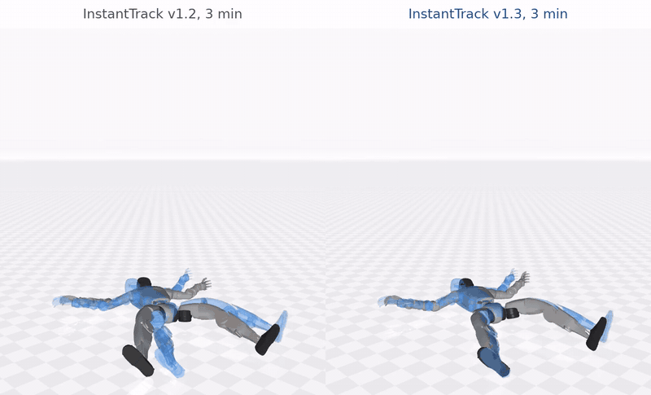
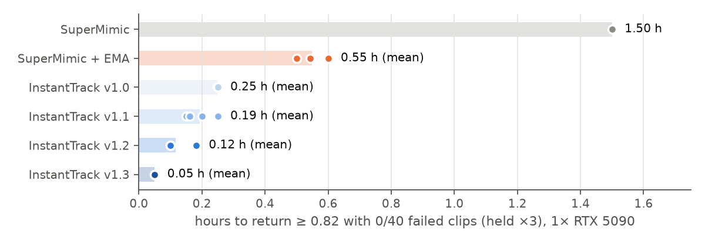
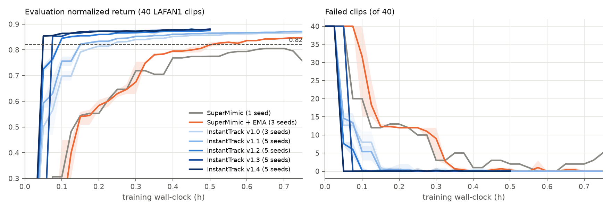

# InstantTrack

**Whole-body motion tracking for the Unitree G1 in about 3 minutes on one GPU.**
InstantTrack trains a single policy for all 40 LAFAN1 clips (2.45 h of motion) to an evaluation
normalized return of 0.82 with **0/40 failed clips at the first checkpoint, 0.05 h (3 minutes), on one
RTX 5090, for all 5 seeds**, and holds it from there. On the same machine, simulator, MDP and
evaluator, our reimplementation of SuperMimic needs **1.50 h**, and SuperMimic with the policy EMA we
add needs **0.55 h**. InstantTrack is also more accurate and makes cleaner foot contact.

> **v1.3.0 (2026-11-04).** v1.3 incorporates the changes of
> [BlinkMimic](https://github.com/fuyichen0725/blinkmimic), a derivative of InstantTrack by Fuyi Chen;
> we thank its author. On top of them, v1.3 adds static-shape compilation, a collection step and
> world-model updates that run on side CUDA streams alongside the policy update, and policy
> learning-rate annealing after the target is reached. Time to target: 0.12 h → **≤ 0.05 h** (first
> checkpoint, all 5 seeds; 4.7× → **≥ 10.9×** over SuperMimic + EMA), 8.74 → 10.32 iterations per
> second, and higher return. Details in [What's new in v1.3](#whats-new-in-v13) and
> [CHANGELOG.md](CHANGELOG.md). The v1.0–v1.2 configurations use flags of the earlier code base;
> check out tag `v1.2.0` to run them.

> **New: InstantGMT (in progress).** InstantTrack's training ideas applied to general motion
> tracking for humanoid teleoperation: one policy for a large VR-teleoperation motion library, with
> the network, observations and deployment interface of a policy already running on a robot, trained
> in hours instead of most of a day on one GPU. Project page:
> <https://huy-quang-dao.github.io/instantTrack/>. Paper in preparation; code to follow.

InstantTrack builds on SuperMimic (one differentiable world model, backpropagation through imagined
rollouts) and adds InstantMimic-style GPU work on the training loop, a few algorithmic changes and a
contact reward. Since v1.3 it includes the changes of BlinkMimic. It runs on [mjlab](https://github.com/mujocolab/mjlab) / MuJoCo Warp and is
installed with [uv](https://docs.astral.sh/uv/).

**Project page:** the InstantTrack page is kept in the [`instanttrack-page`](https://github.com/Huy-Quang-Dao/instantTrack/tree/instanttrack-page) branch. The
GitHub Pages site of this repository now hosts InstantGMT (above).



*Both policies trained for 3 minutes (0.05 h, seed 0) on one RTX 5090, shown on `fallAndGetUp2_subject2`.
At this checkpoint, over all 40 clips, InstantTrack v1.2 fails 8 (`results/runs/v12_gif_s0`, v1.2.0 code) and
InstantTrack v1.3 fails 0 (`results/runs/v13_s0`). Solid robot: policy simulated in MuJoCo Warp. Faint
blue ghost: reference motion. More videos in `media/` of the [`instanttrack-page`](https://github.com/Huy-Quang-Dao/instantTrack/tree/instanttrack-page) branch.*

| on 1× RTX 5090, 40 LAFAN1 clips | SuperMimic | SuperMimic + EMA | InstantTrack v1.1 | InstantTrack v1.2 | **InstantTrack v1.3** |
|---|---|---|---|---|---|
| seeds | 1 | 3 | 5 | 5 | 5 |
| time to return ≥ 0.82 with 0/40 failed clips (held ×3), mean | 1.50 h | 0.55 h | 0.19 h | 0.12 h | **≤ 0.05 h** |
| per seed | 1.50 | 0.50 / 0.54 / 0.60 | 0.15 / 0.16 / 0.25 / 0.20 / 0.20 | 0.10 / 0.10 / 0.10 / 0.10 / 0.18 | 0.05 / 0.05 / 0.05 / 0.05 / 0.05 |
| speed-up over SuperMimic + EMA | 0.4× | 1× | 2.8× | 4.7× | **≥ 10.9×** |
| training iterations per second | 3.05 | 3.08 | 6.28 | 8.74 | **10.32** |
| return / failed clips after 0.15 h (mean) | 0.545 / 12 | 0.540 / 12.3 | 0.822 / 0.2 | 0.855 / 0.2 | **0.865 / 0** |
| return after 1.5 h (seed 0) | 0.853 | 0.879–0.880 | 0.880–0.881 | 0.886 | **0.892** |
| body orientation error, 1.5 h (°, seed 0) | 9.6 | 9.2 | 5.8 | 6.0 | 6.5 |
| contact agreement with the reference, 1.5 h (seed 0) | 0.733 | 0.733 | 0.837 | 0.845 | 0.779 |
| foot slip in contact, 1.5 h (cm/s, seed 0; the reference itself: 10.2) | 8.11 | 7.78 | 6.49 | 6.56 | **6.27** |

0.05 h is the first checkpoint of the 3-minute protocol, so v1.3's time is at most 0.05 h. With a
checkpoint every 100 iterations and 4 evaluation replicas per checkpoint, v1.3 holds the target from
3.2 minutes on average (4.00 / 3.03 / 2.61 min on seeds 0–2), and from 2.74 minutes without the policy
learning-rate annealing (`--pi_anneal_len 0`; see [What's new in v1.3](#whats-new-in-v13)).

All numbers come from runs in this repository. Each run's evaluation log and training log are in
[`results/runs/`](results/runs/), and every table and figure is regenerated from them by
`tools/make_report.py`. Read [How to read these numbers](#how-to-read-these-numbers) before quoting
them.

**Contents:** [What's new in v1.3](#whats-new-in-v13) · [What InstantTrack changes](#what-instanttrack-changes) ·
[Results](#results) · [How to read these numbers](#how-to-read-these-numbers) ·
[Setup](#setup) · [Training](#training) · [Evaluation](#evaluation-and-metrics) ·
[Reproducing the tables](#reproducing-the-tables) · [Repository layout](#repository-layout) ·
[Attribution and licenses](#attribution-and-licenses) · [Citation](#citation)

---

## What's new in v1.3

Release date 2026-11-04. Full list in [CHANGELOG.md](CHANGELOG.md); the notes of v1.2 and earlier are
there too, and the v1.2 README is at tag `v1.2.0`.

**Inherited changes.** v1.3 incorporates the changes of
[BlinkMimic](https://github.com/fuyichen0725/blinkmimic) (Fuyi Chen), which was itself built on
InstantTrack v1.2. They are part of the `instanttrack` preset:

| change | flag |
|---|---|
| Semi-implicit world model: predicts velocity increments and integrates positions | `--wm_structured` |
| Left-right mirror augmentation of half of each world-model batch | `--wm_mirror 0.5` |
| Muon (Newton–Schulz orthogonalized momentum) on the hidden weight matrices of policy and world model | `--pi_opt muon --wm_opt muon` |
| Action built on the next reference pose (replaces v1.1's `--ref_residual`) | `--pi_ref_skip` |
| No world-model-only warm-up | `--wm_only_iters 0` |
| Reset-statistics fixes (duplicate bins; per-clip contact floor of the contact reward) | `--bin_fix --ref_contact_fix` |
| Evaluation-guided resets: from iteration 1000, every 125 iterations the deployed policy is swept over all clips under evaluation conditions; 15 % of the resets go to the 10 s before the places where it fails | `--eprobe_*` |
| Imagined-rollout batch 2048 with a 4× policy learning rate, decayed to 1× over 300 iterations once the training return reaches 0.75 (by iteration 1400 at the latest) | `--pi_batch 2048 --pi_lr_mult 4 --lr_decay_*` |
| Collection step, episode resets and probe sweep as CUDA graphs; the sweep on a side stream; checkpoints written by a background thread | `--graph_early --collect_graph --reset_masked --eprobe_graph --eprobe_async --ckpt_light` |

The policy is back at SuperMimic's size (2048-1024-512-256), and v1.2's batched goal encoding is not
part of v1.3.

**New in v1.3.** Four changes, all part of the `instanttrack` preset:

| change | flag | kind | what it does |
|---|---|---|---|
| Static-shape compilation | `--static_compile` | systems | Every `torch.compile` specializes on static shapes (`dynamic=False`), so a second input shape gets its own graph instead of a slower dynamic-shape recompile. |
| Overlapped collection | `--overlap_collect` | systems | The captured collection step runs on a side CUDA stream with a snapshot of the policy, alongside the world-model and policy updates. Its transitions and normalizer updates enter the replay buffer at the start of the next iteration, so the updates see each step one iteration later. |
| Overlapped world-model updates | `--overlap_wm` | systems | The world-model updates run on a second side stream, concurrently with the policy update. Imagination uses a copy of the world model taken at the start of the iteration, one update round older, which never needs gradients for its weights. The world-model graph is captured on its own stream so the two graphs never share a cuBLAS workspace. |
| Policy learning-rate annealing | `--pi_anneal_len 3000` | algorithm (schedule) | Once the policy learning-rate ramp of `--lr_decay_ret` has ended, the policy learning rate follows a cosine from ×1 to ×0.1 over 3000 iterations and then stays there, so the deployed policy stops drifting across borderline clips after it has reached the target. |

**Effect.** Same protocol as before (see [Time to target](#time-to-target)): a checkpoint every
3 minutes and every 2000 iterations, one evaluation per checkpoint, 5 seeds of 0.5 h.

| | v1.2 | v1.3 |
|---|---|---|
| seeds | 5 | 5 |
| time to target, held ×3 | 0.10 / 0.10 / 0.10 / 0.10 / 0.18 h (mean 0.12) | 0.05 / 0.05 / 0.05 / 0.05 / 0.05 h (≤ 0.05, the first checkpoint) |
| iterations at "held" | 3322 / 3270 / 3336 / 3370 / 6000 | 1895 / 1895 / 1895 / 1907 / 1903 |
| iterations per second | 8.74 | 10.32 |
| return / failed clips after 0.15 h (mean) | 0.855 / 0.2 | 0.865 / 0 |
| return after 0.5 h (mean) | 0.875 | 0.880 |

Of the 95 v1.3 checkpoints (19 per seed), one has a failed clip: seed 3 at 0.164 h
(`jumps1_subject2`), after the target was already held.

**Accuracy.** v1.3 is not better on every metric. At 0.5 h (seeds 0–2, `results/metrics_v13_05h*.md`):

| 0.5 h, mean of seeds 0–2 | return ↑ | body pos (cm) ↓ | body ori (°) ↓ | joints (°) ↓ | contact agreement ↑ | foot slip (cm/s) ↓ | penetration (mm) ↓ | root drift (cm) ↓ |
|---|---|---|---|---|---|---|---|---|
| InstantTrack v1.2 | 0.876 | 3.24 | **6.7** | **4.36** | **0.819** | 6.62 | 0.055 | 59 |
| InstantTrack v1.3 | **0.879** | **3.23** | 7.0 | 4.41 | 0.772 | **6.50** | 0.055 | **45** |

At 1.5 h (seed 0) the pattern is the same: v1.3 has the higher return, less slip and less root drift, and
v1.2 has the lower orientation and joint errors and the higher contact agreement (0.845 against 0.779).
The lower contact agreement most likely comes from `--ref_contact_fix` (not tested by an ablation): v1.3's contact reward uses a per-clip
calibrated floor for the reference contact, while the metric keeps the fixed 4.5 cm threshold of all
earlier versions, so v1.3 is trained to match a different contact label than the one measured. We kept
the metric unchanged so the versions stay comparable. If contact agreement under the fixed threshold
matters for your use, train without `--ref_contact_fix`; we have not measured that configuration.

**Finer time resolution.** The 3-minute protocol cannot resolve times below 0.05 h. With a checkpoint
every 100 iterations and every checkpoint evaluated 4 times (a clip counts as failed if it fails in
any replica), the release configuration holds the target (×3) from 4.00 / 3.03 / 2.61 minutes on seeds 0–2, 3.21 min on average
(`scripts/fine_protocol.sh`, `tools/time_to_target.py`, runs `v13fine_s*`).

**Where the v1.3 changes come from** (development runs, same fine protocol, seeds 0–2; the time held
×3 in minutes, mean):

| | held ×3 (min) | it/s |
|---|---|---|
| starting point: v1.2 lineage with the inherited changes (`v13dev_base_s*`) | 3.68 / 2.99 / 4.37 (3.68) | 8.92 |
| + static-shape compilation | 3.32 / 3.54 / 2.96 (3.27) | 8.85 |
| + overlapped collection | 3.27 / 2.54 / 2.77 (2.86) | 9.51 |
| + overlapped world-model updates | 2.86 / 2.68 / 2.67 (2.74) | 10.29 |
| + policy learning-rate annealing = release configuration (`v13fine_s*`) | 4.00 / 3.03 / 2.61 (3.21) | 10.12 |

From the starting point (3.68 min), v1.3's static-shape compilation and overlapped streams bring the
time to **2.74 min (1.34× faster, 15 % more iterations per second)**, on seeds 0–2 (development runs).
This configuration is the `instanttrack` preset with `--pi_anneal_len 0`. The release preset keeps the
annealing and takes 3.21 min.

The policy learning-rate annealing was added last, for holding the target, not for speed: on the fine
protocol it does not lower the time (3.21 min against 2.74 min, with seed 0 the slowest at 4.00 min). On the 3-minute protocol,
without it seed 0 held the target only from 0.17 h (`jumps1_subject2` and `fallAndGetUp1_subject1`
failed at 0.054 h, `fallAndGetUp2_subject3` at 0.15 h), and with it all five development seeds held
it by 0.10 h (0.05 / 0.05 / 0.10 / 0.05 / 0.05 h; best return 0.873–0.878 against 0.873–0.874). Logs:
`results/runs/v13dev_*`.

**Tried in this round and not adopted** (development runs on the fine protocol; numbers under
[What did not help](#what-did-not-help); these flags were removed from the code): prioritized
imagination starts (by training failure rate or by the evaluation sweep's failures), extra imagination
starts at sweep failure frames, world-model windows weighted toward failing segments, a high-priority
stream for the policy update, a shorter imagination horizon early in training, and several
hyperparameter changes (EMA 0.99, earlier learning-rate decay, earlier or more frequent sweeps, a larger
sweep share, 2 critic epochs).

**Compatibility.** Breaking change. v1.3 replaces the training code: the flags of v1.0–v1.2 that are
not listed above (`--ref_residual`, `--muon`, `--batch_goal_enc` and the variants under "What did not
help") are gone, and v1.0–v1.2 checkpoints do not load into v1.3's networks. Check out tag `v1.2.0`
to run or evaluate the earlier versions. `--overlap_collect` needs `--collect_graph --reset_masked
--no_sync`, and `--overlap_wm` needs `--cuda_graph`.

## What InstantTrack changes

The baseline is SuperMimic (Liao et al., 2026). One world model, an MLP 2048³, predicts the next
robot state. The policy is trained by backpropagating the imagined return through 32 world-model
steps, with a critic bootstrap, and a replay buffer is filled from 4096 simulated robots. Run with no
flags, `python -m instanttrack.train` is this baseline with the paper's hyperparameters. **Every
InstantTrack change is a flag**, so all methods share the simulator, MDP, reward, termination, domain
randomization and evaluator.

| change | flag | kind | what it does |
|---|---|---|---|
| EMA policy | `--pi_ema 0.995` | algorithm | Checkpoints and evaluation use a Polyak average of the policy weights. On its own this is ~2.7× faster than SuperMimic, so **we count SuperMimic + EMA as the fair baseline**. |
| No host syncs | `--no_sync` | systems | Fixed-size start sampling (stable sort) and on-GPU checks for frozen normalizers and non-finite gradients, so no CPU↔GPU sync happens inside an iteration. |
| Fused optimizer | `--fused_adam` | systems | Fused Adam, plus compiled GAE targets and critic loss. |
| Fused 3×3 rotations | `--fused_rot` | systems | Rotation products in FK, reward, observation and world model are written element-wise, so inductor fuses them instead of sending them to cuBLAS as batched GEMVs. Same result to 1.5e-6. |
| More compilation | `--compile_more` | systems | `torch.compile` of reward, termination, observation, goal and the world-model normalizer inputs. |
| Learning-rate / WM updates | `--lr 4e-4 --wm_batches 5` | hyperparameters | lr 4e-4 instead of the paper's 2e-4 and 5 instead of 10 world-model batches per iteration. |
| Smaller world model | `--wm_hidden 1024,1024,1024` | architecture size | Same per-iteration learning and +28 % iterations per second. |
| Failure-focused resets | `--fail_reset 0.3` | algorithm | Tracks a per-bin termination rate (EMA) at the 1 s bin where each episode fails. 30 % of resets start one bin before recent failure points, mixed with SuperMimic's return-based bin sampling. Removes most of the single-clip "flicker" that delays the 3-checkpoint criterion. |
| Contact reward | `--contact_reward 0.25` | reward (training only) | In imagination, a differentiable foot-contact indicator, σ((4.5 cm − z_ankle) / 5 mm), is matched to the reference contact state, and horizontal foot speed is penalized while the reference foot is down. **Evaluation uses the unchanged SuperMimic reward.** |
| Reference-residual policy (v1.1; since v1.3 `--pi_ref_skip`) | `--pi_ref_skip` | architecture | The decoder outputs a correction on top of the next reference joint pose (read from the goal input) instead of an offset from the default pose, so an untrained policy already commands the reference. |
| Muon (v1.2; since v1.3 `--pi_opt muon --wm_opt muon`) | `--pi_opt muon --wm_opt muon` | algorithm | Muon for the hidden weight matrices of the world model and the policy; Adam for the rest and for the critic. |
| CUDA-graph updates (v1.2) | `--cuda_graph` | systems | World-model and policy + critic updates captured once as CUDA graphs and replayed. |
| Batched goal encoding (v1.2 only) | — | systems | The motion encoder ran once per imagined rollout on all its goals. Not part of v1.3. |
| Smaller policy (v1.2 only) | `--enc_hidden 1024,512,256 --dec_hidden 1024,512,256` | network size (hyperparameter) | Policy encoder and decoder 1024-512-256. v1.3 uses SuperMimic's 2048-1024-512-256 again. |
| Inherited from BlinkMimic (v1.3) | see [What's new in v1.3](#whats-new-in-v13) | world model, optimizer, resets, systems | Semi-implicit world model with mirror augmentation, evaluation-guided resets, rollout batch 2048 with a decayed 4× policy learning rate, CUDA graphs for collection and the probe sweep. |
| Static-shape compilation (v1.3) | `--static_compile` | systems | `torch.compile` with `dynamic=False`. |
| Overlapped collection (v1.3) | `--overlap_collect` | systems | The collection step runs on a side CUDA stream alongside the updates; its data enters the buffer one iteration later. |
| Overlapped world-model updates (v1.3) | `--overlap_wm` | systems | The world-model updates run on a second side stream, concurrently with the policy update, which imagines with the world model of the iteration start. |
| Policy learning-rate annealing (v1.3) | `--pi_anneal_len 3000` | algorithm (schedule) | After the target return is reached, the policy learning rate anneals by a cosine to ×0.1 over 3000 iterations. |

Per iteration, the v1.0 systems changes take the training loop from 315 ms to 209 ms under
`torch.profiler`, and from 25.3k to 15.2k CUDA kernel launches. The largest single item was ~57 ms of
fp32 `aten::bmm` from 3×3 rotations. That breakdown comes from `train.py --torch_profile 5` and
`tools/trace_summary.py` of tag `v1.2.0`. In v1.3, the policy update (BPTT through 32 world-model
steps) is the critical path at about 61 ms per iteration when measured alone, against about 23 ms for
the world-model updates and 20 ms for collection; with the overlap the three take about 82 ms
together, and the GPU is then compute-bound.

## Results

Setup for all runs: one NVIDIA RTX 5090 (32 GB) with 32 CPU threads and 4096 parallel environments.
The software stack is mjlab 1.6.0, MuJoCo Warp 3.11, Warp 1.16 and torch 2.9.0 + CUDA 12.8. A
checkpoint is saved every 3 minutes of training wall-clock and evaluated offline afterwards, so
evaluation time is not counted as training time. The v1.2-round runs saved a checkpoint every 1.5
minutes; all tables use only their checkpoints that fall on the 3-minute schedule (every 0.05 h and
every 2000 iterations), so every method is compared on the same schedule. The v1.3 runs use that
schedule directly.

### Time to target

**Target:** evaluation normalized return ≥ 0.82 with 0 of 40 clips failed, **held for 3 consecutive
checkpoints**. We use the 0.82 threshold of the SuperMimic paper and add the 0-failure and
held-for-3 conditions, so a single lucky checkpoint does not count.



| method | seeds | held at (h) | mean (h) | iteration at held | it/s | vs SuperMimic + EMA |
|---|---|---|---|---|---|---|
| SuperMimic | 1 | 1.50 | 1.50 | 16665 | 3.05 | 0.4× |
| SuperMimic + EMA | 3 | 0.50 / 0.54 / 0.60 | 0.55 | 5749 / 6000 / 6971 | 3.08 | 1.0× |
| InstantTrack v1.0 | 3 | 0.25 / 0.25 / 0.25 | 0.25 | 5900 / 6000 / 5956 | 6.32 | 2.2× |
| InstantTrack v1.1 | 5 | 0.15 / 0.16 / 0.25 / 0.20 / 0.20 | 0.19 | 3687 / 4000 / 5847 / 4868 / 4787 | 6.28 | 2.8× |
| InstantTrack v1.2 | 5 | 0.10 / 0.10 / 0.10 / 0.10 / 0.18 | 0.12 | 3322 / 3270 / 3336 / 3370 / 6000 | 8.74 | 4.7× |
| **InstantTrack v1.3** | 5 | **0.05 / 0.05 / 0.05 / 0.05 / 0.05** | **≤ 0.05** | 1895 / 1895 / 1895 / 1907 / 1903 | **10.32** | **≥ 10.9×** |

The speed-up has two sources. v1.3 runs 3.4× more iterations per second than SuperMimic, and it
needs fewer iterations: all five seeds meet the target at the first checkpoint, ~1.9k iterations,
against 5.7k–7.0k for SuperMimic + EMA and ~3.3k for four of five v1.2 seeds. Because that is the
first checkpoint, the 3-minute protocol only bounds v1.3's time (≤ 0.05 h); the finer measurement is in
[What's new in v1.3](#whats-new-in-v13). Additional 1.5 h runs of seed 0 held the target from 0.20 h
(v1.0, `e67_final_long_s0`, and v1.1, `e80_rres10_long_s0`), 0.12 h (v1.2, `e111_v12_long_s0`) and
0.05 h, its first checkpoint (v1.3, `v13_150h_s0`; 1 of its 57 checkpoints had a failed clip, at 1.10 h).

### Equal training time



Mean over seeds of normalized return / failed clips:

| method | 0.15 h | 0.25 h | 0.50 h | 0.75 h |
|---|---|---|---|---|
| SuperMimic (1 seed) | 0.545 / 12 | 0.646 / 10 | 0.775 / 2 | 0.757 / 5 |
| SuperMimic + EMA | 0.540 / 12.3 | 0.630 / 12.0 | 0.819 / 0.3 | 0.847 / 0.0 |
| InstantTrack v1.0 | 0.791 / 1.0 | 0.831 / 0.0 | 0.857 / 0.0 | 0.867 / 0.0 |
| InstantTrack v1.1 (5 seeds) | 0.822 / 0.2 | 0.844 / 0.0 | 0.865 / 0.0 | **0.871 / 0.0** |
| InstantTrack v1.2 (5 seeds, 0.5 h runs) | 0.855 / 0.2 | 0.866 / 0.0 | 0.875 / 0.2 | — |
| **InstantTrack v1.3** (5 seeds, 0.5 h runs) | **0.865 / 0.0** | **0.872 / 0.0** | **0.880 / 0.0** | — |

At 0.5 h one v1.2 seed (seed 4) has one failed clip at that checkpoint.

### Tracking accuracy and contact

All 40 clips are run once from their first frame, with no randomization or noise, a deterministic
policy and friction 1.0. Metrics are averaged over all alive control steps (`tools/eval_metrics.py`).
Mean ± std over 3 seeds, after **0.75 h** of training:

| method | return ↑ | failed ↓ | body pos (cm) ↓ | body ori (°) ↓ | joints (°) ↓ | contact agreement ↑ | foot slip (cm/s) ↓ | penetration (mm) ↓ | root drift (cm) ↓ |
|---|---|---|---|---|---|---|---|---|---|
| SuperMimic (1 seed) | 0.775 | 4 | 5.29 | 12.5 | 6.15 | 0.727 | 8.44 | 0.066 | 116 |
| SuperMimic + EMA | 0.852 ± 0.002 | 0 | 4.60 ± 0.03 | 11.1 ± 0.2 | 5.61 ± 0.05 | 0.719 ± 0.001 | 8.00 ± 0.06 | 0.063 ± 0.003 | **54 ± 1** |
| InstantTrack v1.0, no contact reward | **0.873 ± 0.001** | 0 | 3.50 ± 0.08 | 7.7 ± 0.3 | 4.15 ± 0.02 | 0.738 ± 0.002 | 7.73 ± 0.08 | 0.057 ± 0.001 | 58 ± 3 |
| InstantTrack v1.0 | 0.867 ± 0.001 | 0 | 3.53 ± 0.04 | 7.5 ± 0.1 | 4.56 ± 0.02 | 0.812 ± 0.000 | 6.62 ± 0.04 | **0.052 ± 0.001** | 61 ± 5 |
| **InstantTrack v1.1** | 0.872 ± 0.003 | 0 | **3.20 ± 0.04** | **6.5 ± 0.0** | **4.12 ± 0.01** | **0.817 ± 0.003** | **6.59 ± 0.05** | 0.055 ± 0.001 | 61 ± 3 |

The v1.1 row uses seeds 0–2 (`results/metrics_a1_075h.md`). The v1.2 runs are 0.5 h long; their
accuracy at 0.5 h, against v1.1 at 0.5 h, is in `results/metrics_v12_05h.md`, and v1.3 against v1.2 at
0.5 h is in [What's new in v1.3](#whats-new-in-v13).

After **1.5 h** of training (seed 0):

| method | return | body pos (cm) | body ori (°) | joints (°) | contact agreement | foot slip (cm/s) | penetration (mm) | root drift (cm) |
|---|---|---|---|---|---|---|---|---|
| SuperMimic | 0.853 | 4.16 | 9.6 | 4.84 | 0.733 | 8.11 | 0.064 | 84 |
| SuperMimic + EMA | 0.880 | 3.83 | 9.2 | 4.65 | 0.733 | 7.78 | 0.057 | 49 |
| InstantTrack v1.0, no contact reward | 0.890 | 3.03 | 5.9 | **3.70** | 0.752 | 7.56 | 0.052 | 42 |
| InstantTrack v1.0 | 0.877 | 3.27 | 6.4 | 3.98 | 0.829 | 6.48 | **0.046** | 62 |
| InstantTrack v1.1 | 0.881 | **2.95** | **5.8** | 3.76 | 0.837 | 6.49 | 0.050 | 55 |
| InstantTrack v1.2 | 0.886 | 3.01 | 6.0 | 3.96 | 0.845 | 6.56 | 0.047 | 52 |
| **InstantTrack v1.3** | **0.892** | 2.99 | 6.5 | 4.12 | 0.779 | **6.27** | 0.050 | **39** |

The v1.1 row was evaluated in a later session (`results/metrics_a1_150h.md`). In that session we
re-evaluated the SuperMimic + EMA and v1.0 checkpoints as well, and got return 0.879 / 0.878 and root
drift 50 / 59 cm, against 0.880 / 0.877 and 49 / 62 cm above. Re-running the evaluator on the same
checkpoint therefore moves return by about ±0.001 and root drift by a few cm (MuJoCo Warp on the GPU
is not bit-deterministic), so differences of that size between rows are not meaningful. The v1.2 row
comes from a third session (`results/metrics_v12_150h.md`), which gave 0.879 / 0.880 return and
50 / 55 cm root drift for SuperMimic + EMA / v1.1.

Definitions:
- *Body pos / ori*: RMS error of the 14 tracked bodies, with the reference re-anchored to the robot
  root as in the reward.
- *Contact agreement*: fraction of foot-frames whose contact state (ankle-roll origin below 4.5 cm)
  matches the reference.
- *Foot slip*: horizontal foot speed while the simulated foot is in contact.
- *Root drift*: global root position error.

Full tables: [`results/metrics_075h.md`](results/metrics_075h.md),
[`results/metrics_150h.md`](results/metrics_150h.md) (v1.0 and baselines),
[`results/metrics_a1_075h.md`](results/metrics_a1_075h.md),
[`results/metrics_a1_150h.md`](results/metrics_a1_150h.md) and
[`results/metrics_r2a_075h.md`](results/metrics_r2a_075h.md) (v1.1 round),
[`results/metrics_v12_05h.md`](results/metrics_v12_05h.md) and
[`results/metrics_v12_150h.md`](results/metrics_v12_150h.md) (v1.2 round).

### Ablation ladder

Each row adds one change to the row above. Times are "held ×3".

| configuration | seeds | held at (h) | mean (h) | it/s | best return |
|---|---|---|---|---|---|
| SuperMimic (paper hyperparameters) | 1 | 1.50 | 1.50 | 3.05 | 0.863 |
| + EMA policy 0.995 | 3 | 0.50 / 0.54 / 0.60 | 0.55 | 3.08 | 0.879 / 0.850 / 0.854 |
| + lr 4e-4, 5 WM batches, no host syncs, fused Adam | 3 | 0.29 / 0.30 / 0.35 | 0.31 | 3.51 | 0.872 / 0.867 / 0.873 |
| + fused 3×3 rotations | 1 | 0.30 | 0.30 | 4.14 | 0.872 |
| + compiled reward / obs / goal | 3 | 0.25 / 0.25 / 0.49 | 0.33 | 4.88 | 0.878 / 0.878 / 0.875 |
| + world model 1024³ (was 2048³) | 3 | 0.30 / 0.20 / 0.30 | 0.27 | 6.35 | 0.878 / 0.880 / 0.881 |
| + failure-focused resets | 3 | 0.20 / 0.20 / 0.25 | 0.22 | 6.29 | 0.875 / 0.874 / 0.874 |
| + contact reward 0.25 = **InstantTrack v1.0** | 3 | 0.25 / 0.25 / 0.25 | 0.25 | 6.32 | 0.869 / 0.869 / 0.864 |
| + reference-residual policy = **InstantTrack v1.1** | 5 | 0.15 / 0.16 / 0.25 / 0.20 / 0.20 | 0.19 | 6.28 | 0.873 / 0.873 / 0.871 / 0.874 / 0.873 |
| v1.1 again, 0.5 h runs with 1.5-minute checkpoints (reference for the rows below) | 3 | 0.15 / 0.15 / 0.16 | 0.15 | 6.29 | 0.863 / 0.862 / 0.863 |
| + Muon (`--muon`) | 3 | 0.10 / 0.15 / 0.17 | 0.14 | 6.13 | 0.875 / 0.875 / 0.877 |
| + CUDA-graph updates, batched goal encoding | 3 | 0.10 / 0.15 / 0.10 | 0.12 | 6.98 | 0.878 / 0.879 / 0.877 |
| + policy 1024-512-256 = **InstantTrack v1.2** | 5 | 0.10 / 0.10 / 0.10 / 0.10 / 0.18 | 0.12 | 8.74 | 0.877 / 0.876 / 0.876 / 0.875 / 0.875 |
| inherited BlinkMimic changes + static compilation, overlapped collection and world-model updates, policy lr annealing = **InstantTrack v1.3** | 5 | 0.05 / 0.05 / 0.05 / 0.05 / 0.05 | ≤ 0.05 | 10.32 | 0.882 / 0.880 / 0.880 / 0.884 / 0.885 |

Best return is over the run: 2 h for SuperMimic, 0.75 h up to v1.1, 0.5 h for the last five rows. The
steps from v1.2 to v1.3 are broken down, on a finer protocol, in [What's new in v1.3](#whats-new-in-v13).

The contact reward costs ~0.03 h of time-to-target and ~0.007 return. In exchange, contact agreement
rises from 0.74 to 0.81 and foot slip falls 15 %. If you only care about the SuperMimic metric, use
the `instanttrack_track` preset, which is the row above it.

### What did not help

We report every variant we tried; single seed unless stated. Most were tried on an earlier
configuration (the "on top of" column), so read them as directions, not final verdicts.

| change | on top of | seeds | held at (h) | it/s |
|---|---|---|---|---|
| Smaller policy and WM (1024-512-256) | SuperMimic | 1 | 1.20 | 4.20 |
| Demonstration replay (DiffMimic) | SuperMimic + EMA | 1 | 0.59 | 3.18 |
| Policy batch 2048 | SuperMimic + EMA | 1 | 0.55 | 3.66 |
| EMA 0.999 | SuperMimic + EMA | 1 | 0.55 | 3.13 |
| lr 6e-4 | + lr 4e-4, wm5 | 1 | 0.40 | 3.27 |
| 3 WM batches | + lr 4e-4 | 1 | 0.45 | 3.93 |
| Horizon 24 | + lr 4e-4, wm5 | 1 | 0.30 | 4.31 |
| Horizon 16 | + compile_more | 1 | 0.30 | 7.02 |
| Foot-contact world-model loss 0.05 (PhysMamba-style) | + lr 4e-4, wm5 | 1 | 0.35 | 3.30 |
| Anchored imagination (on-policy corrections) | + lr 4e-4, wm5 | 1 | 0.31 | 3.02 |
| 2 critic epochs | + lr 4e-4, wm5 | 1 | 0.40 | 3.81 |
| UTD 0.5 | + lr 4e-4, wm5 | 1 | 0.40 | 3.72 |
| CUDA graphs (`--cudagraphs`, torch.compile reduce-overhead) | + compile_more | 1 | 0.25 | 5.11 |
| WM window 4 | + compile_more | 1 | 0.25 | 5.45 |
| Contact-mode world model (`--wm_contact 0.1`, 4 heads mixed by predicted foot contact) | + fail_reset | 3 | 0.30* / 0.20 / 0.20 | 6.12 |
| Contact reward 0.5 | + fail_reset | 3 | 0.25 / 0.30 / 0.35 | 6.21 |
| Wide-kernel root reward 0.5, std 1 m (`--root_reward 0.5`) | v1.0 | 1 | 0.28 | 6.30 |
| Wide-kernel root reward 1.0, std 1 m | v1.0 | 1 | 0.35 | 6.28 |
| Wide-kernel root reward 0.5, std 0.5 m (`--root_reward_std 0.5`) | v1.0 | 1 | 0.25 | 6.35 |
| Reference residual β = 0.5 (v1.1 uses 1.0; same seed: 0.15 h) | v1.0 | 1 | 0.17 | 6.20 |
| WM ensemble, 4 heads, disagreement penalty 100 (`--wm_ens 4 --wm_ens_pen 100`) | v1.1 | 1 | 0.25 | 6.12 |
| WM ensemble, 4 heads, disagreement penalty 300 | v1.1 | 1 | 0.35 | 6.09 |
| Mixture-of-experts policy, 2 decoders (`--pi_experts 2`) | v1.1 | 1 | 0.20 | 5.18 |
| EMA 0.997 (seed 2; v1.1 seed 2: 0.25 h) | v1.1 | 1 | 0.40 | 6.29 |
| Failure-focused resets 0.5 (seed 2; v1.1 seed 2: 0.25 h; tuning, one seed) | v1.1 | 1 | 0.15 | 6.36 |
| Horizon 24 | v1.1, 0.5 h | 1 | 0.15 | 7.40 |
| Horizon 16 | v1.1, 0.5 h | 1 | 0.20 | 8.99 |
| lr 6e-4 (tuning) | v1.1, 0.5 h | 3 | 0.15 / 0.30 / 0.15 | 6.30 |
| lr 6e-4 + horizon 24 | v1.1, 0.5 h | 1 | 0.20 | 7.49 |
| lr 6e-4 + failure-focused resets 0.5 | v1.1, 0.5 h | 1 | 0.15 | 6.38 |
| 200 world-model-only iterations (was 100) | v1.1, 0.5 h | 1 | 0.15 | 6.23 |
| CUDA-graph updates without Muon | v1.1, 0.5 h | 1 | 0.15 | 6.95 |
| CUDA-graph updates + policy 1024-512-256 without Muon | v1.1, 0.5 h | 2 | 0.15 / 0.15 | 8.97 |
| SimBa residual policy 512×2 (`--pi_simba 512x2`) | v1.1, 0.5 h | 2 | 0.20 / 0.15 | 6.07 |
| Muon on the policy only (`--muon --muon_on pi`) | v1.1, 0.5 h | 1 | 0.15 | 6.32 |
| Muon on the world model only (`--muon --muon_on wm`) | v1.1, 0.5 h | 1 | 0.20 | 6.09 |
| Spectral norm on the world model (`--wm_specnorm`) | v1.1, 0.5 h | 1 | 0.20 | 6.10 |

\* This run followed a machine reboot that cleared the torch.compile cache. Cold compilation cost
about 0.05 h of it.

The v1.1-round variants were compared with the same seed of the configuration they modify (v1.0
seed 0: 0.25 h; v1.1 seed 0: 0.15 h). The v1.2-round variants ("v1.1, 0.5 h") were compared with
v1.1 re-run for 0.5 h with 1.5-minute checkpoints (seeds 0 / 1 / 2: 0.15 / 0.15 / 0.16 h). Root drift at 0.75 h for the three root-reward runs was 56,
57 and 60 cm, against 53 cm for v1.0 seed 0 evaluated in the same session
([`results/metrics_r2a_075h.md`](results/metrics_r2a_075h.md)).

Contact reward 0.5 reaches the highest contact agreement (0.87–0.88) and the lowest slip (6.3 cm/s),
but it trades away more pose accuracy and root drift. Per-run logs for everything above are in
[`results/runs/`](results/runs/). The list of commands is in
[`experiments/all_runs.txt`](experiments/all_runs.txt), and every run's flags are in
`results/runs/<run>/args.json`.

**v1.3 round.** Tried on top of the development configuration with the overlapped collection (and,
where noted, the overlapped world-model updates), on the fine protocol (a checkpoint every 100
iterations, 4 evaluation replicas). The column is the time held ×3 in minutes per seed; the
reference rows are the configurations they modify (seeds 0 / 1 / 2). These flags are not in the v1.3
code; the logs are in `results/runs/v13dev_*`.

| change | on top of | seeds | held ×3 (min) |
|---|---|---|---|
| reference: overlapped collection | | 3 | 3.27 / 2.54 / 2.77 |
| reference: + overlapped world-model updates | | 3 | 2.86 / 2.68 / 2.67 |
| Prioritized imagination starts, weight 1 + 2 × training failure rate of the start bin | overlapped collection | 3 | 3.27 / 2.73 / 4.67 |
| Prioritized imagination starts, weight from the evaluation sweep's failure windows | overlapped collection | 2 | 3.10 / 2.75 |
| World-model windows weighted toward failing bins (weight 2) | + overlapped WM | 3 | 2.68 / 2.18 / 2.68 (held ×6: 3.70 / 3.87 / 2.68) |
| Extra imagination starts (12.5 %) at sweep failure frames | + overlapped WM | 2 | held at iteration 2000 / 2200 (reference: 1800 / 1700) |
| Policy update on a high-priority CUDA stream | + overlapped WM | 1 | no change in it/s (11.9 vs 12.0), stopped |
| Imagination horizon 16 for the first 1000 iterations | starting point | 3 | 5.38 / 3.61 / 4.56 (reference 3.68 / 2.99 / 4.37) |
| EMA 0.99 (tuning) | overlapped collection | 2 | 3.20 / 3.44 |
| Learning-rate decay by iteration 1100 (tuning) | overlapped collection | 2 | 3.79 / 4.90 |
| First sweep at iteration 600 (tuning) | overlapped collection | 2 | 4.30 / 3.62 |
| Sweep share 0.3 (tuning) | overlapped collection | 1 | 3.83 |
| Sweep every 60 iterations (tuning) | overlapped collection | 1 | 4.45 |
| 2 critic epochs | + static compilation | 3 | 3.84 / 3.30 / 3.13 (reference 3.32 / 3.54 / 2.96) |

The extra-starts run of seed 0 recompiled cold (new batch shape), so it is compared by iterations.

## How to read these numbers

- **The baseline is our reimplementation, not the authors' code.** No official SuperMimic code is
  released. Our SuperMimic is the mjlab port of
  [`supermimic_vibed`](https://github.com/zita-ch/supermimic_vibed), an independent reimplementation
  of the paper. The SuperMimic paper reports reaching 0.82 after ~1.2 h on an H100. We measure
  1.50 h on an RTX 5090 with our own, stricter "0 failures, held ×3" criterion. Treat the speed-up as
  InstantTrack **vs our SuperMimic on the same machine**, not vs the paper's numbers.
- **EMA does most of the early work.** A Polyak-averaged policy alone takes SuperMimic from 1.50 h to
  0.55 h. That is why SuperMimic + EMA is the baseline we quote the 4.7× against, and it is a change
  any SuperMimic implementation can adopt. The same holds for v1.1's reference-residual policy: it is
  not specific to InstantTrack and could be added to SuperMimic as well; we have not measured that.
- **How v1.3 was chosen.** v1.3 starts from BlinkMimic's code (InstantTrack v1.2 plus BlinkMimic's
  changes), so part of the gain from v1.2 to v1.3 comes from the inherited changes; the "starting
  point" row in [What's new in v1.3](#whats-new-in-v13) is that code before our v1.3 changes. Our four
  changes were selected on development runs (fine protocol, seeds 0–2, then 0–4). The learning-rate
  annealing was added after seed 0 of the development configuration held the target only from 0.17 h
  on the 3-minute protocol. All v1.3 numbers in the tables are from new runs of the released code
  (`results/runs/v13_*`), not from the development runs.
- **v1.3 is at the resolution limit.** All five v1.3 seeds meet the target at the first 3-minute
  checkpoint, so the protocol gives an upper bound (≤ 0.05 h) and the speed-up over SuperMimic + EMA
  is a lower bound (≥ 10.9×). The fine protocol (a checkpoint every 100 iterations, 4 evaluation
  replicas) gives the times in minutes; it is stricter per checkpoint (a clip that fails in any replica
  counts) and not comparable to the 3-minute numbers of earlier versions.
- **How v1.2 was chosen.** v1.2 combines the changes that helped among the variants tried after
  v1.1 (see [What did not help](#what-did-not-help)). It was assembled on seeds 0–2 and then run on
  two more seeds (3 and 4); seed 4 was the slowest of the five (0.18 h). Its accuracy at 0.5 h is
  measured on 3 seeds and at 1.5 h on one run. Muon could be applied to SuperMimic too; we have not measured that. The smaller policy is a
  network-size choice: with SuperMimic's policy size, v1.2's other changes give 0.10 / 0.15 / 0.10 h
  on seeds 0–2 (see [About the smaller policy](#about-the-smaller-policy)).
- **How v1.1 was chosen.** v1.1 is the best of eight variants tried after v1.0 (see
  [What did not help](#what-did-not-help)); it was selected on seed 0 and then confirmed on four more
  seeds. Its accuracy at 0.75 h is measured on 3 of the 5 seeds and at 1.5 h on one run.
- **Seeds and resolution.** 3 seeds per method (v1.1, v1.2, v1.3: 5); plain SuperMimic has 1 seed. Checkpoints are 3
  minutes (0.05 h) apart, so times are quantized to 0.05 h. Runs on one GPU are not bit-reproducible.
  Re-running the same seed moved one configuration from 0.30 h to 0.34 h.
- **Muon's learning rate under `--cuda_graph` (v1.2).** Muon's lr is a Python float, so it is fixed when the
  update is captured and does not follow the cosine schedule (Adam's lr is a tensor and does). With
  the default `--lr_decay_iters 250000`, the scheduled lr after 1.5 h (~47k iterations) is 0.92× the
  initial one, so in all v1.2 runs Muon's lr was at most 8 % above the schedule.
  In v1.3, Muon (`--pi_opt muon --wm_opt muon`, a capturable implementation) keeps its lr in a tensor, so
  it follows the schedule and the policy annealing under CUDA graphs.
- **Training time.** Time is training wall-clock on a GPU used by nothing else. It includes
  torch.compile warm-up, about 15 s with a warm cache and about 3 min cold, and checkpoint writing.
  It excludes the offline evaluation.
- **Where InstantTrack is worse.**
  - Global root drift is larger: 55–64 cm for v1.1 and 52 cm for v1.2 (one 1.5 h run) against
    49–54 cm for SuperMimic + EMA. Feet that
    stick to the ground do not follow the reference where the reference itself slides (10.2 cm/s of
    slip from retargeting). An imagination-only root reward did not fix this.
  - v1.0 reached a normalized return of 0.877 at 1.5 h, against 0.880 for SuperMimic + EMA. v1.1
    reaches 0.881, which is within evaluation noise of SuperMimic + EMA. v1.2 reaches 0.886 (one
    run), above the ±0.001 evaluation noise.
  - Hard clips can regress after the target is first met (v1.2 seed 4, `jumps1_subject2`), which
    delays "held ×3". In v1.3 this happened once in 95 checkpoints (seed 3 at 0.164 h,
    `jumps1_subject2`), after the target was held. The clips that hold v1.3 back early are the jump of
    `jumps1_subject2` (around frame 12040) and a few falls and get-ups (`fallAndGetUp1_subject4`,
    `fallAndGetUp1_subject5`, `dance1_subject1`, `dance2_subject4`); each fails at a fixed moment of
    the clip until the policy learns it, typically by iteration ~2300.
  - Without the contact reward, InstantTrack v1.0 beats SuperMimic + EMA on every metric we measure.
- **Scope.** Only the Unitree G1 in simulation, on LAFAN1 (40 clips). Evaluation has no domain
  randomization and no pushes. There is no sim-to-real experiment and no larger motion set.

## Setup

**Requirements:**
- Linux x86_64.
- An NVIDIA GPU with a driver for CUDA 12.8 (tested: RTX 5090, driver 580; CUDA 12.8 needs ≥ 570).
- [uv](https://docs.astral.sh/uv/getting-started/installation/), `git`, `curl`.
- `ffmpeg`, only for rendering videos.
- About 10 GB of disk for the environment and data, plus about 2 GB per 0.75 h run for checkpoints.

```bash
git clone https://github.com/Huy-Quang-Dao/instantTrack.git
cd instantTrack
uv sync                          # creates .venv: mjlab, MuJoCo Warp, Warp, torch 2.9.0 (CUDA 12.8)
tools/download_data.sh           # LAFAN1 G1 retargets (40 clips) + G1 description -> data/, builds data/g1_description/g1_29dof.xml
uv run python tools/test_env.py  # sanity check: FK vs simulator (~1e-6), state round-trip, reference playback
```

`tools/download_data.sh` fetches the G1-retargeted LAFAN1 clips and the G1 URDF and meshes from the
Hugging Face dataset
[`lvhaidong/LAFAN1_Retargeting_Dataset`](https://huggingface.co/datasets/lvhaidong/LAFAN1_Retargeting_Dataset),
then converts the URDF to MJCF. The motion data is not redistributed in this repository; see the
licenses below.

## Training

Presets are defined in [`scripts/presets.sh`](scripts/presets.sh):

| preset | flags | use |
|---|---|---|
| `supermimic` | none | SuperMimic baseline, paper hyperparameters |
| `supermimic_ema` | `--pi_ema 0.995` | fair baseline |
| `instanttrack` | see [`scripts/presets.sh`](scripts/presets.sh) (v1.0 base, inherited changes, `--static_compile --overlap_collect --overlap_wm --pi_anneal_len 3000`) | **main configuration (v1.3)** |

The presets of v1.0–v1.2 (`instanttrack_track`, `instanttrack_v1.0`, `instanttrack_v1.1` and the v1.2
`instanttrack`) use flags of the earlier code base: check out tag `v1.2.0` to run them.

```bash
# train InstantTrack for 0.5 h (seed 0), then evaluate all its checkpoints
scripts/train.sh instanttrack it_s0 --seed 0 --max_hours 0.5

# the baselines
scripts/train.sh supermimic_ema sm_ema_s0 --seed 0 --max_hours 0.75
scripts/train.sh supermimic     sm_s0     --seed 0 --max_hours 2
```

`scripts/train.sh` runs `python -m instanttrack.train --log_dir logs/<run> <preset flags> <extra flags>`
and then `tools/eval_batch.py`. Train directly with, for example:

```bash
source scripts/presets.sh
uv run python -m instanttrack.train --log_dir logs/my_run --seed 0 --max_hours 0.5 ${PRESET[instanttrack]}
```

`--cuda_graph` needs `--no_sync --fused_adam`; `--overlap_collect` needs `--collect_graph
--reset_masked --no_sync`; `--overlap_wm` needs `--cuda_graph`. The graphs are captured in the first
iterations; capture takes a few seconds and is included in the training time.

> **Train on an otherwise idle GPU.** On a shared GPU the asynchronous probe sweep (`--eprobe_async`)
> can crash with an illegal memory access; add `--eprobe_async 0` there.

Each run writes the following to `logs/<run>/`:
- `train_log.csv`: per-50-iteration losses, imagined and simulated return, and it/s.
- `ckpt_<iteration>.pt` every 3 min (`--ckpt_minutes`) and every 2000 iterations (`--ckpt_every`).
  With `--ckpt_light` (part of the preset) these hold only the deployed (EMA) policy `pi`, written by
  a background thread; `last.pt` at the end of the run holds the full training state (`pi` is the
  EMA policy, `pi_live` the raw one).
- `args.json` and `stdout.log`.

Other useful flags:

| flag | default | meaning |
|---|---|---|
| `--seed` | 0 | random seed |
| `--max_hours` | none | stop after this much training wall-clock |
| `--num_envs` | 4096 | parallel simulated robots |
| `--horizon` | 32 | imagination horizon H |
| `--ckpt_minutes` | 3 | wall-clock checkpoint interval |
| `--ckpt_every` | 2000 | iteration checkpoint interval (`scripts/fine_protocol.sh` uses 100) |

A run never shares its GPU in our measurements. A second process on the same GPU slows the loop
1.5–2×. To run many experiments in sequence, list them in a file, one `<run_name> <train.py flags>`
per line, and start `tools/queue.sh <file>`, for example in tmux.

## Evaluation and metrics

```bash
uv run python tools/eval_batch.py --run_dir logs/it_s0                 # every checkpoint -> logs/it_s0/eval.csv
uv run python tools/compare.py logs/sm_ema_s0 logs/it_s0 --out results/compare   # time-to-target table + curves
uv run python tools/eval_metrics.py logs/it_s0/ckpt_017324.pt --out results/metrics   # pose / contact metrics
uv run python -m instanttrack.evaluate --run_dir logs/it_s0 --ckpt logs/it_s0/ckpt_017324.pt --record traj.npz
uv run python tools/render.py traj.npz video.mp4 --clips fallAndGetUp1_subject1 jumps1_subject1 --seconds 12
```

The evaluation protocol follows SuperMimic App. F.1:
- Each of the 40 clips is played once from its first frame, with the deterministic policy and no
  randomization or noise.
- A clip *fails* if the termination condition (root height or tilt error) fires.
- *Normalized return* is a clip's return divided by the maximum possible return over the whole clip, averaged over clips. Steps after a failure count as zero.
- `tools/eval_batch.py` evaluates many checkpoints in one simulator, 40 worlds per checkpoint. With
  `--reps 4` every checkpoint is evaluated 4 times (`eval_r4.csv`); `tools/time_to_target.py` reads
  those files. If an evaluation process crashes (we saw two rare simulator faults in the v1.3 round),
  run it again: checkpoints already in the CSV are skipped.

```bash
scripts/fine_protocol.sh it_fine_s0 0     # checkpoint every 100 iterations for 0.1 h, 4 replicas, time in minutes
```

## Reproducing the tables

```bash
scripts/reproduce_main.sh                                 # SuperMimic + EMA 3 seeds × 0.75 h, InstantTrack 5 seeds × 0.5 h (~6 h)
METHODS="supermimic" scripts/reproduce_main.sh            # plain SuperMimic (use --max_hours 2 to reach the target)
uv run python tools/make_report.py                        # rebuild results/report.md + figures from results/runs/
```

`tools/make_report.py` reads `results/runs/<run>/{eval.csv,train_log.csv}`. These are the files of
our runs, copied from `logs/`. To report your own runs, copy them there or pass `--runs logs`.

## Repository layout

| path | contents |
|---|---|
| `src/instanttrack/train.py` | training loop: collect → world-model fit → BPTT policy + critic; all InstantTrack flags, CUDA-graph capture, side-stream overlap, evaluation-guided resets |
| `src/instanttrack/networks.py` | world model (optionally semi-implicit), policy (goal encoder + decoder, optional reference-action skip), critic, running normalizers |
| `src/instanttrack/optim.py`, `objective.py`, `mirror.py` | Muon + Adam optimizer (capturable), actor objective, left-right mirror maps |
| `src/instanttrack/env.py` | batched mjlab tracking simulator, return-based and failure-focused reset sampling |
| `src/instanttrack/mdp.py` | observation, BeyondMimic-style reward (+ contact term), termination |
| `src/instanttrack/kinematics.py`, `rotations.py` | differentiable FK; fused `mm3` / `mv3` rotations |
| `src/instanttrack/motion.py`, `buffer.py`, `dr.py`, `sensing.py` | reference motions and goals, replay buffer, domain randomization, observation noise |
| `src/instanttrack/evaluate.py`, `g1/` | evaluator; Unitree G1 robot spec |
| `tools/` | data download, evaluation, metrics, time to target, comparison, report, rendering, ONNX export and check |
| `scripts/` | presets, train + evaluate, fine-protocol run, reproduction of the main table |
| `results/` | report tables, figures, and per-run logs (`results/runs/`) |
| `experiments/all_runs.txt` | the command lines of the experiment queue |
| `CHANGELOG.md` | release history |

## Attribution and licenses

- **Method.** Q. Liao, Y. Shao, J. Long, K. Zakka, R. Horowitz, P. Abbeel, K. Sreenath,
  *SuperMimic: Scaling Humanoid Whole-Body Control with One Differentiable World Model*,
  arXiv:2610.28480, 2026 ([project page](https://supermimic.github.io)). InstantTrack is an
  independent work and is not affiliated with or endorsed by the SuperMimic authors.
- **BlinkMimic.** v1.3 incorporates the changes of [BlinkMimic](https://github.com/fuyichen0725/blinkmimic)
  by Fuyi Chen, a derivative of InstantTrack; we thank its author. The parts derived from it remain under
  its MIT License (Copyright (c) 2026 Fuyi Chen), whose notice is kept in
  [THIRD_PARTY_NOTICES.md](THIRD_PARTY_NOTICES.md).
- **Code base.** InstantTrack started from [`supermimic_vibed`](https://github.com/zita-ch/supermimic_vibed)
  by Chong Zhang (ETH Zurich), an unofficial SuperMimic reimplementation, in its mjlab port. The parts
  derived from it remain under its MIT License (Copyright (c) 2026 ETH Zurich, Chong Zhang), whose
  notice is kept in [THIRD_PARTY_NOTICES.md](THIRD_PARTY_NOTICES.md).
- **Training-loop engineering** follows the ideas of I. Choi, G. Leem, J. Won, *InstantMimic: A High
  Performance System for Learning Physics-based Skills in Seconds*, arXiv:2609.09821, 2026: profile
  first, fuse kernels, remove host syncs.
- **Related work we drew on or tested:**
  - SuperTrack (Fussell, Bergamin, Holden, ACM TOG / SIGGRAPH Asia 2021).
  - BeyondMimic (Liao et al., Science Robotics 2026), for the reward and evaluation protocol.
  - SHAC (Xu et al., ICLR 2022).
  - DiffMimic (Ren et al., ICLR 2023), demonstration replay.
  - Suh et al., *Do Differentiable Simulators Give Better Policy Gradients?* (ICML 2022).
  - PhysMamba (Zhang & Todorovic, arXiv:2610.04014), foot-contact loss.
  - Muon (K. Jordan et al., 2024; J. Liu et al., *Muon is Scalable for LLM Training*, 2025).
- **Simulation.**
  - [mjlab](https://github.com/mujocolab/mjlab) (K. Zakka et al., arXiv:2601.22074; Apache-2.0).
  - [MuJoCo](https://mujoco.org) (Todorov, Erez, Tassa, IROS 2012; Apache-2.0).
  - [MuJoCo Warp](https://github.com/google-deepmind/mujoco_warp) (Apache-2.0).
  - [NVIDIA Warp](https://github.com/NVIDIA/warp) (Apache-2.0).
  - [PyTorch](https://pytorch.org) (BSD-3-Clause).
  - All are used unmodified.
- **Data.**
  - LAFAN1 motions by Ubisoft La Forge: F. G. Harvey, M. Yurick, D. Nowrouzezahrai, C. Pal,
    *Robust Motion In-betweening*, ACM TOG (SIGGRAPH) 2020. License: **CC BY-NC-ND 4.0**.
  - G1 retargets and robot description: Unitree (BSD-3-Clause), via the Hugging Face dataset
    `lvhaidong/LAFAN1_Retargeting_Dataset`.
  - The motion data is **not redistributed** here. The GIF, videos and trained checkpoints are derived
    from LAFAN1. They are provided for non-commercial research and illustration only and are **not
    covered by this repository's MIT license**.

## Citation

If you use InstantTrack, please cite this repository. Please also cite the works it builds on, in
particular SuperMimic, InstantMimic, mjlab and LAFAN1:

```bibtex
@misc{instanttrack2026,
  title   = {InstantTrack: Whole-Body Motion Tracking for the Unitree G1 in Minutes on One GPU},
  author  = {Huy-Quang-Dao},
  year    = {2026},
  version = {1.3.0},
  url     = {https://github.com/Huy-Quang-Dao/instantTrack}
}
@article{liao2026supermimic,
  title   = {SuperMimic: Scaling Humanoid Whole-Body Control with One Differentiable World Model},
  author  = {Liao, Qiayuan and Shao, Yiyang and Long, Junfeng and Zakka, Kevin and Horowitz, Roberto and Abbeel, Pieter and Sreenath, Koushil},
  journal = {arXiv preprint arXiv:2610.28480},
  year    = {2026}
}
@article{choi2026instantmimic,
  title   = {InstantMimic: A High Performance System for Learning Physics-based Skills in Seconds},
  author  = {Choi, Ikjun and Leem, Geonho and Won, Jungdam},
  journal = {arXiv preprint arXiv:2609.09821},
  year    = {2026}
}
@misc{zakka2026mjlab,
  title         = {mjlab: A Lightweight Framework for GPU-Accelerated Robot Learning},
  author        = {Zakka, Kevin and Liao, Qiayuan and Yi, Brent and Le Lay, Louis and Sreenath, Koushil and Abbeel, Pieter},
  year          = {2026},
  eprint        = {2601.22074},
  archivePrefix = {arXiv},
  primaryClass  = {cs.RO}
}
@article{harvey2020robust,
  title   = {Robust Motion In-betweening},
  author  = {Harvey, F{\'e}lix G. and Yurick, Mike and Nowrouzezahrai, Derek and Pal, Christopher},
  journal = {ACM Transactions on Graphics (Proceedings of ACM SIGGRAPH)},
  volume  = {39},
  number  = {4},
  pages   = {60:1--60:12},
  year    = {2020}
}
@inproceedings{todorov2012mujoco,
  title     = {MuJoCo: A physics engine for model-based control},
  author    = {Todorov, Emanuel and Erez, Tom and Tassa, Yuval},
  booktitle = {IEEE/RSJ International Conference on Intelligent Robots and Systems},
  pages     = {5026--5033},
  year      = {2012}
}
```

## License

The code is released under the [MIT License](LICENSE). Copyright (c) 2026 Huy-Quang-Dao.
Data-derived files (GIFs, videos, checkpoints) are excluded; see [Attribution and licenses](#attribution-and-licenses).
